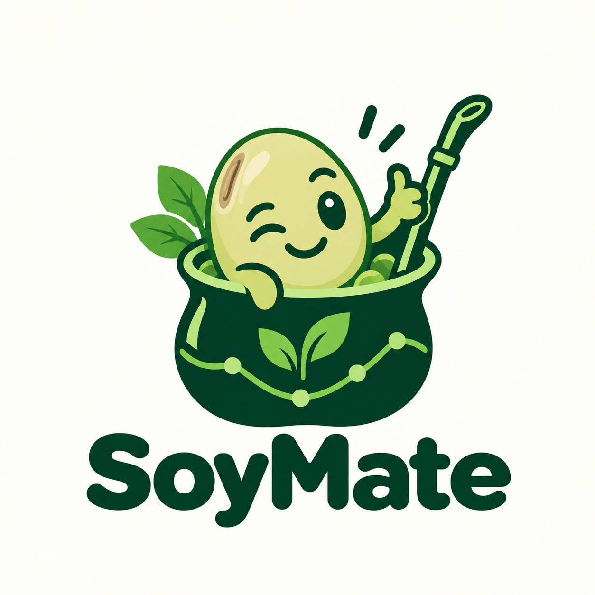

<p align="center">
  
</p>

# SoyMate

**Phone-photo quality control for pulses at grain intake.** A grain collector's intake technician takes a photo of a sample of peas or lentils; SoyMate separates every grain, classifies it (sound, broken, insect-holed, stained, foreign material), estimates the share of each defect with a confidence interval, and says whether the lot meets the human-food criterion or goes to animal feed.

Project for **Hack the Fork Paris 2026** (AgroParisTech, Palaiseau, 30 October to 1 November 2026), **Track 3: Protein sovereignty, from French fields to the proteins of tomorrow**.

> **Single source of truth:** [`CONTEXT.md`](CONTEXT.md). Every figure in it carries its source (`[S#]`) and a confidence tag. If anything in this repo disagrees with it, `CONTEXT.md` wins.

---

## Why

- Whether a lot of pulses is sold for human food (better price) or animal feed is decided at intake, today by looking at and counting grains by hand.
- Bruchid damage and broken grains are the main reasons lots lose the human-food outlet. The figures, thresholds and their sources are in [`CONTEXT.md` §3](CONTEXT.md).
- Image-based grain analysis exists for cereals (for example Inarix in France), but we found no tool doing it for pulses.

## How

1. **Photo:** phone, plain matte background, 30 to 200 grains.
2. **Separate:** threshold and contours (a pretrained segmenter such as SAM if grains touch).
3. **Classify:** frozen pretrained features (DINOv2) plus a small linear classifier, trained on CPU.
4. **Decide:** percentage per class with a binomial interval, compared with the chosen threshold.

There is no public image dataset of damaged peas, lentils or faba beans. We train on the best open insect-damage dataset (soybean, which we audited and re-split because the published split leaks), plus cereal datasets, and **measure the transfer** to French peas and lentils with our own photos taken during the event. The transfer curve (no tuning vs 5, 10, 25, 50 labelled grains per class) is the core result. Soybean is only training data; the product and the demo are about French pulses for human food.

## Repository layout

```
.
├── README.md              this file
├── CONTEXT.md             single source of truth: problem, data, method, plan, pitch, sources
├── assets/logo.png
├── docs/
│   ├── soymate_team_plan.pdf     short plan for the team (flow, roles, schedule, checkpoints)
│   └── soymate_data_report.pdf   data report with plots
├── research/              pre-event data exploration for SoyMate (no models trained)
│   ├── README.md
│   ├── soybean_bruchid/   audit of the soybean pulse-beetle dataset + leak-free re-split CSV
│   ├── other_datasets/    survey of 16 seed and grain image datasets
│   └── context/           intake standards, soybean for food, competitors, photo protocol
├── event/                 Hack the Fork participant guide
└── archive/               earlier idea exploration (ideas 1 to 8), kept for reference
```

## Hackathon rules we follow

- No solution code, model, prototype, results or pitch deck before the event starts. Everything in this repo up to the event is desk research and data exploration; no model was trained.
- Pre-existing resources (public datasets, pretrained models, the derived CSVs and analyses in `research/`) are declared at submission. See [`CONTEXT.md` §14](CONTEXT.md).
- Data provenance is labelled as measured, sourced, assumed or synthetic.

## Data

Datasets are downloaded at the event, never committed (`data/` is git-ignored). The full dataset map, licences and download links are in [`CONTEXT.md` §6](CONTEXT.md). Main ones:

| Dataset | Use | Licence |
|---|---|---|
| Soybean pulse-beetle infestation (Mendeley d97rjyk2tz) | Insect exit-hole detection (proof of concept) | CC BY 4.0 |
| GrainSet (Scientific Data 2023) | Broken and pest-damaged kernels, expert labels | CC BY 4.0 |
| corn1000 (Hugging Face) | Counting grains in multi-grain phone photos | CC BY-NC 4.0 |
| Radio_lentille (Terres Inovia, Hugging Face) | X-rays of bruchid-damaged French lentils, validation | MIT |
| Our own photos | French peas and lentils, transfer evaluation | Ours |

## Team

Three people, Hack the Fork Paris 2026. Repository is private.
