# Idea 1, EDA climate × crop: phase-based indices, SAFRAN vs dataset climate, 1981-2024 climatology

> Note: the plots in this folder still have Spanish titles and axis labels (they were renamed to English filenames but not regenerated). The text below is in English.

Exploratory analysis done on 30/10/2026, before the hackathon. **No model was trained, there are no splits or cross-validation.** Everything below is descriptive statistics, group means and rank correlations shown as exploration (no variable selection).

Tags: **[V]** I computed it myself on the data; **[F]** comes from a source; **[NV]** my own inference.

**Data used:** Pea_dataset (doi 10.57745/FW78RE, downloaded today from Recherche Data Gouv) and daily SAFRAN/SIM2 (`QUOT_SIM2_<year>.csv.gz`, 1981-2024, downloaded today from `meteofrance.s3.sbg.io.cloud.ovh.net`). For each year I kept the 133 SAFRAN cells closest to the 158 sites (mean distance 3.1 km, max 5.1 km [V]) and the daily mean of the cells of 8 départements (02, 10, 17, 28, 45, 51, 60, 80), using `num_dep` from the DBF `SHP_SIM_FRANCE.dbf`. The raw files were deleted after processing.

**Scripts:** `scratchpad/en_wx/scripts/` from the session (`01_cells.py`, `02_proc_year.py`, `dl_one.sh`, `03_trials.py`, `04_indices.py`, `05_plots_trials.py`, `06_plots_time.py`, `07_fingerprint.py`, `common.py`).

**Small artifacts kept here:**
- `trial_indices.csv` (362 kB): 354 trials site-year × type, median dates, mean protein and yield, and ~180 climate indices by phase (prefix `ds_` = dataset climate, `sf_` = SAFRAN).
- `dept_safran_indices_1981_2024.csv` (353 rows): annual indices by département.

**Warning:** the two CSVs are an exploratory result from before the event. If they are used in the hackathon, they must be **declared as a pre-existing resource or regenerated** with the scripts (about 15 min of SAFRAN download).

---

## 0. How I built the indices

- **Unit:** trial = site × harvest year × type (winter/spring). There are 354 trials for 2003-2024 and **250 with protein in ≥3 genotypes (173 spring, 77 winter, 14 years)** [V].
- **Trial dates:**
  - sowing = median of `sowing_date`;
  - flowering = median of `start_flo_date`;
  - harvest = median of `harvest_date`. If it is missing or gives a filling period < 20 or > 120 days, I use flowering + 55 d (15 trials imputed, including the LE_RHEU 2013 error) [V].
- **Windows:**
  - `pre`: 60 days before sowing;
  - `veg`: sowing → flowering;
  - `fille`: early filling, flowering → +30 d (what is known at D2);
  - `filll`: late filling, +30 d → harvest;
  - `fill`: full filling, flowering → harvest;
  - `season`: sowing → harvest;
  - `cold`: sowing → 1/3, winter only.
- **Indices per window:**
  - rain, PET and rain − PET (mm);
  - mean Tmax and mean T (°C);
  - days with Tmax > 25 and > 30 °C;
  - radiation (MJ/m²);
  - growing degree-days base 0 (°C·d);
  - days with Tmin < 0 and < −5 °C, minimum Tmin;
  - with SAFRAN also mean and minimum SWI (fraction, 1 = field capacity).
- **Variable equivalences between sources:**
  - Tmax: SAFRAN `TSUP_H`, dataset `TX`;
  - Tmin: SAFRAN `TINF_H`, dataset `TN`;
  - rain: SAFRAN `PRELIQ + PRENEI`, dataset `RR`;
  - radiation: SAFRAN `SSI/100`, dataset `RG/100`.
- **D2:** here it is "flowering + 30 d" (not the fixed 15/06 from the dossier), so that the date means the same thing in winter and in spring.

---

## 1. Plots

### 01. Season timeline and decision dates
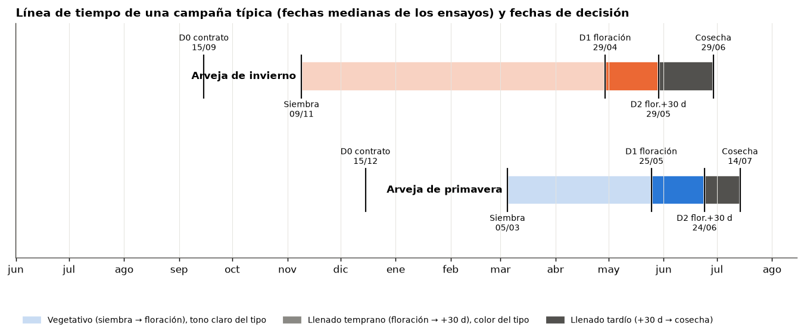

**What it shows:** the median trial dates and the decision dates [V]:
- winter: sowing 09/11, flowering 29/04, D2 29/05, harvest 29/06;
- spring: sowing 05/03, flowering 25/05, D2 24/06, harvest 14/07;
- D0 (contract): 15/09 for winter and 15/12 for spring.

**Why it matters:** filling, which is where protein is set, covers only the last ~50-60 days. In spring, more than 5 months pass between D0 and flowering with no filling signal. This is the skeleton of the demo slider.

### 02. How much information there is at each decision date
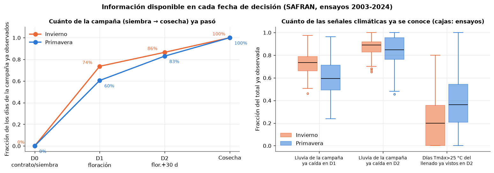

**What it shows:** what fraction of the season has passed at each date, and what fraction of each signal has already been observed. Medians per trial [V]:

| | Spring | Winter |
|---|---|---|
| Season days already passed at D1 | 60% | 74% |
| Season days already passed at D2 | 83% | 86% |
| Season rain already fallen at D1 | 59% | 73% |
| Season rain already fallen at D2 | 85% | 89% |
| Days > 25 °C of filling already seen at D2 | **36%** | **20%** |

**Why it matters:** at D2, 85% of the calendar has already passed, but **most of the filling heat has not happened yet**. The D2 forecast still depends on scenarios for the final stretch, more so in winter.

### 03. Protein vs heat days during filling
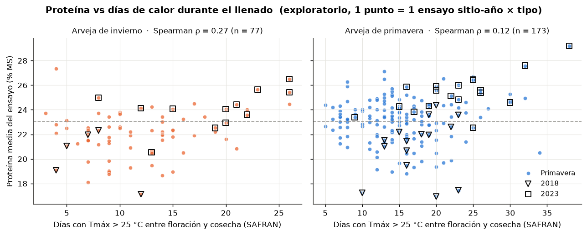

**What it shows:** mean trial protein against days with Tmax > 25 °C between flowering and harvest (SAFRAN), with 2018 (▽) and 2023 (□) marked [V]:
- winter: ρ = +0.27 (n = 77);
- spring: ρ = +0.12 (n = 173).

**Why it matters:** the relation is **positive and weak**: more heat during filling goes with *more* protein, not less. It fits a concentration effect: stress cuts starch accumulation more than N accumulation [NV mechanism]. The 2023 squares sit top right. The 2018 triangles sit low but spread across the whole heat range: **heat alone does not explain 2018**.

### 03b. Protein vs mean Tmax during filling
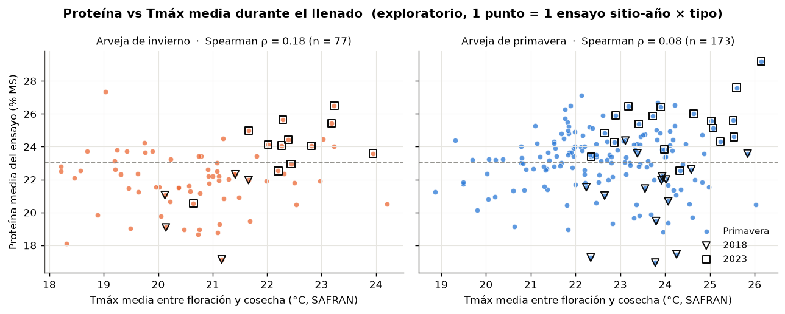

**What it shows:** the same with mean Tmax: ρ = +0.18 for winter and +0.08 for spring [V].

**Why it matters:** it confirms the sign and how weak the relation is. The count of days > 25 °C separates a bit more than the mean does.

### 04. Protein vs water balance during filling
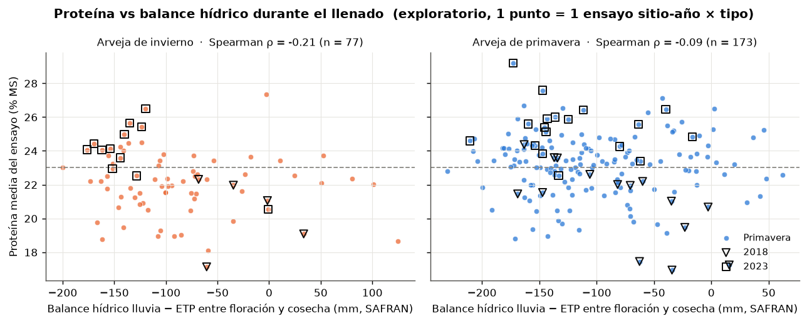

**What it shows:** protein against rain − PET between flowering and harvest [V]:
- winter: ρ = −0.21;
- spring: ρ = −0.09.

**Why it matters:** a drier filling goes with somewhat more protein, which is consistent with plot 03. Heat and drought are correlated with each other, so they are not two independent signals.

### 05. Protein vs rain over the whole season
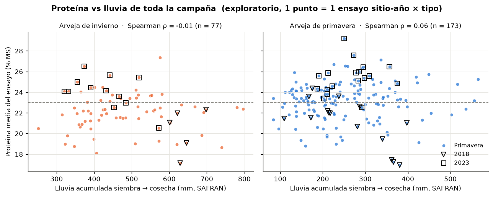

**What it shows:** protein against cumulative rain from sowing → harvest: ρ ≈ 0 (−0.01 winter, +0.06 spring) [V].

**Why it matters:** season totals are not useful. If there is a signal, it is in the **phase**, which justifies building the indices per phenological window.

### 06. Protein vs filling SWI
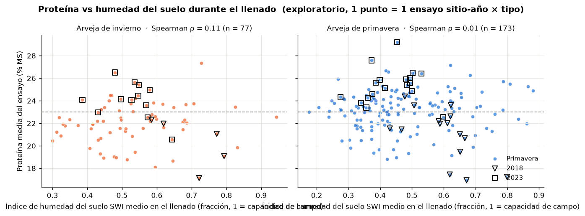

**What it shows:** protein against SAFRAN soil moisture (mean SWI during filling): ρ = +0.11 for winter and +0.01 for spring [V].

**Why it matters:** for protein, SWI adds nothing beyond rain − PET. It does show up in winter yield (plot 08).

### 07. Yield vs heat days during filling
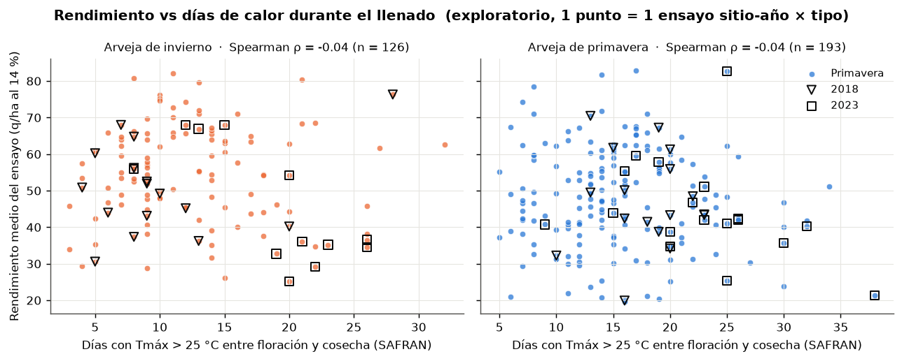

**What it shows:** mean trial yield (q/ha) against days > 25 °C during filling: ρ = −0.04 for both types (n = 126 winter, 193 spring) [V].

**Why it matters:** with full filling there is no heat signal on yield. There is one in **early filling** in spring (mean Tmax flowering → +30 d: ρ = −0.30, plot 08).

### 07b. Yield vs filling water balance
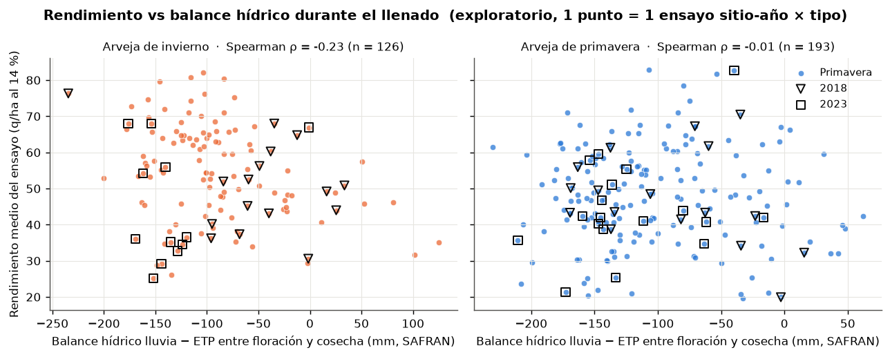

**What it shows:** yield against rain − PET during filling: ρ = −0.23 for winter and −0.01 for spring [V].

**Why it matters:** in winter, **excess water** is associated with lower yield (see SWI in plot 08). The water signal on winter yield is waterlogging, not drought [NV mechanism].

### 08. Rank correlation map (exploratory)
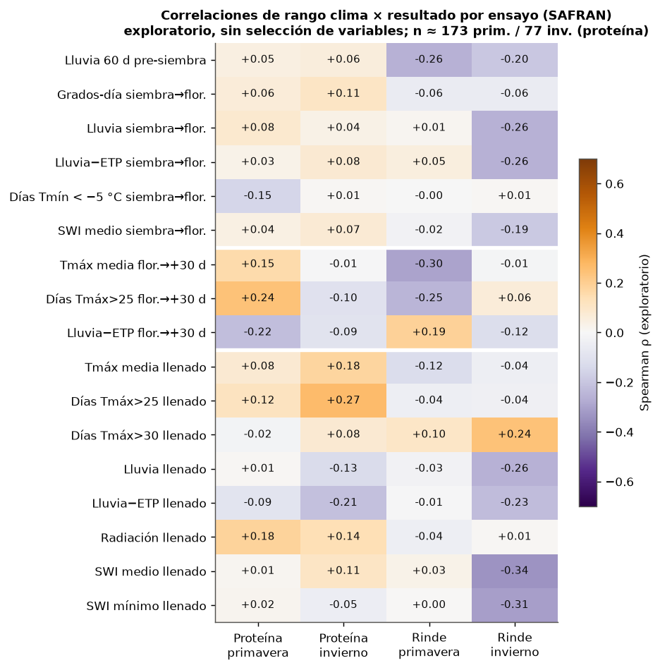

**What it shows:** the Spearman ρ of 17 SAFRAN indices against protein and yield, by type. There is no selection: these are all the indices I built [V].

**Highest values for protein:**
- winter: days > 25 °C during filling, +0.27;
- spring: days > 25 °C flowering → +30 d, +0.24;
- spring: rain − PET flowering → +30 d, −0.22.

**Highest values for yield:**
- winter: mean SWI during filling, −0.34;
- spring: mean Tmax flowering → +30 d, −0.30;
- rain in the 60 days before sowing: −0.26 (spring) and −0.20 (winter).

**Why it matters:** no |ρ| goes above 0.35. With 77-173 trials and 12-14 years, these are small and noisy signals.
- Consistent pattern: **heat and drought in early filling** raise protein and lower yield in spring, that is, the dilution trade-off.
- For winter yield, what matters is **excess water**.

### 09. Climate or year effect? (confounding)
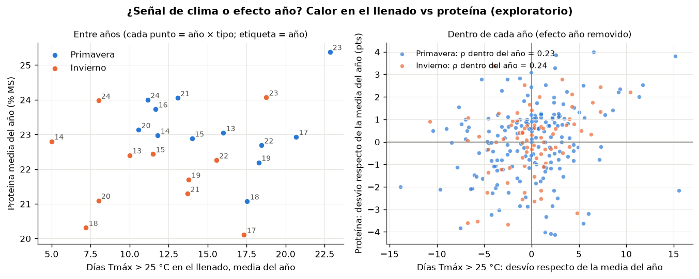

**What it shows:** the same heat-protein relation looked at between years and within each year [V]:

| | Spring | Winter |
|---|---|---|
| ρ between years (annual means) | −0.31 (12 years) | −0.01 (11 years) |
| ρ within year (deviations from the annual mean) | +0.23 (n = 173) | +0.24 (n = 77) |
| Share of protein variance between years | 25% | 30% |
| Total SD | 1.97 | 1.95 |
| SD within year | 1.71 | 1.63 |

**Why it matters:** **the between-year and within-year signals have opposite signs in spring.**
- Between years other things dominate: 2018 was hot and had low protein.
- There are suspicions of an underlying trend: varietal turnover, high 2023-2024 [NV].
- A model that learns "heat ⇒ protein" may be learning the year.
- The year effect is ~25-30% of the variance, and it is exactly what leave-one-year-out validation tests.

### 10. Source change: dataset climate vs SAFRAN
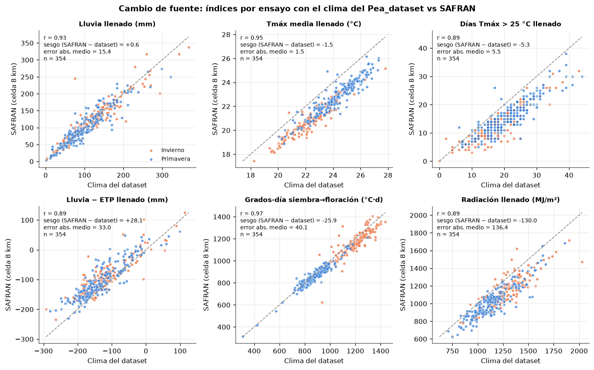

**What it shows:** the same per-trial indices computed with the Pea_dataset climate and with the SAFRAN cell (n = 354) [V]:

| Index | r | Bias SAFRAN − dataset | Mean abs. error |
|---|---|---|---|
| Filling rain | 0.93 | +0.6 mm | 15.4 mm |
| Filling mean Tmax | 0.95 | **−1.5 °C** | 1.5 °C |
| Filling days > 25 °C | 0.89 | **−5.3 days** | 5.5 days |
| Filling rain − PET | 0.89 | +28 mm | 33 mm |
| Growing degree-days sowing → flowering | 0.97 | −26 °C·d | 40 °C·d |
| Filling radiation | 0.89 | −130 MJ/m² | 136 MJ/m² |

- The worst case is AVANCON 2017: filling rain of 76 mm in the dataset vs 245 mm in SAFRAN, which matches the coordinate problem already known [V].
- Correlations with protein look similar with both sources (filling days > 25 °C) [V]:
  - spring: +0.20 with the dataset vs +0.12 with SAFRAN;
  - winter: +0.20 vs +0.27.

**Why it matters:** `TSUP_H` (the maximum of hourly temperatures over an 8 km cell) **comes out systematically lower** than the dataset Tmax. So the absolute thresholds (> 25, > 30 °C) count different things depending on the source. **You cannot train on one source and forecast with the other without recalibrating.**

### 11. Preview of the "forecast update" by tertiles (descriptive)
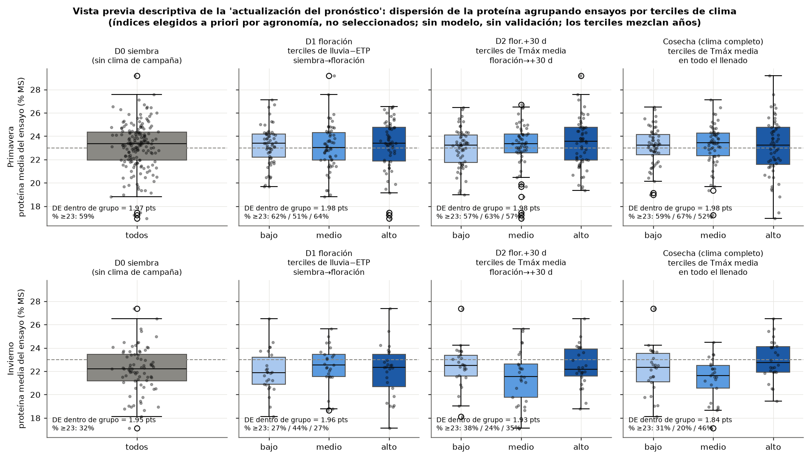

**What it shows:** how protein is spread when I group the trials by tertiles of an index available at each date. I chose the indices **a priori on agronomic grounds**, before looking at correlations:
- D1: rain − PET sowing → flowering;
- D2: mean Tmax flowering → +30 d;
- at harvest: mean Tmax over full filling.

**Spring [V]:**
- the SD within groups **does not drop**: 1.97 (D0), 1.98, 1.98 and 1.98;
- the % ≥ 23 per tertile moves little: 59% → 62/51/64 → 57/63/57 → 59/67/52.

**Winter [V]:**
- the SD barely drops: 1.95, 1.96, 1.93 and 1.84;
- with full filling, the % ≥ 23 goes 31% / 20% / 46% (low / mid / high).

**Why it matters:** this is the honest test that **a single climate index does not shrink the uncertainty**, at least not visibly. The consequences:
- the demo's "funnel" (the uncertainty that narrows from D0 to D2) **is not guaranteed**;
- if it appears, it will come from combining variables (type, breeder protein class, region, phase) and from the part of filling that has already happened;
- we need to be ready to say it narrows only a little and to sell the calibration, not the sharpness.

The tertiles mix years (see plot 09).

### 12. Demo seasons: 2018 vs 2023 against each site's climatology
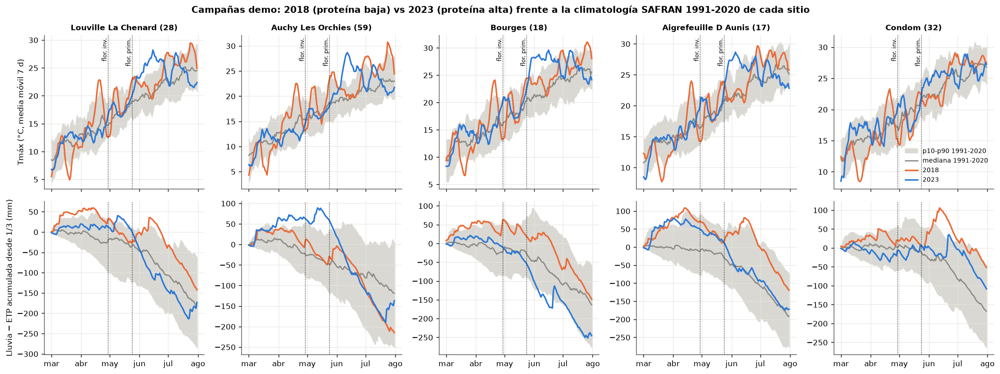

**What it shows:** five sites with protein in 2018 or 2023 (Louville-la-Chenard 28, Auchy-les-Orchies 59, Bourges 18, Aigrefeuille-d'Aunis 17, Condom 32):
- top: Tmax with a 7-day moving mean, from March to July;
- bottom: cumulative rain − PET from 1 March;
- in grey, the p10-p90 band and the 1991-2020 median of SAFRAN.

**Days with Tmax > 25 °C in June-July [V]:**

| Site | 2018 | 2023 | Mean 1991-2020 |
|---|---|---|---|
| Louville | 29 | 27 | 17.1 |
| Bourges | 37 | 45 | 24.6 |

**Cumulative rain − PET to 30/06 [V]:**

| Site | 2018 | 2023 | Median 1991-2020 |
|---|---|---|---|
| Louville | −39 mm | −144 mm | −106 mm |
| Bourges | −70 mm | −154 mm | −109 mm |
| Aigrefeuille | +2 mm | −91 mm | −105 mm |

**Why it matters:** **both years were hot; the difference is in the water and in the timing.**
- 2023 starts a strong heat right after spring flowering (late May / June), with a fast drying of the balance.
- 2018 came from a wet winter and spring, with the balance above the median until June, and the heat peak came later, in July.

It is the clearest chart for the pitch.

### 13. SAFRAN climatology 1981-2024 by département: how unusual were 2018 and 2023?
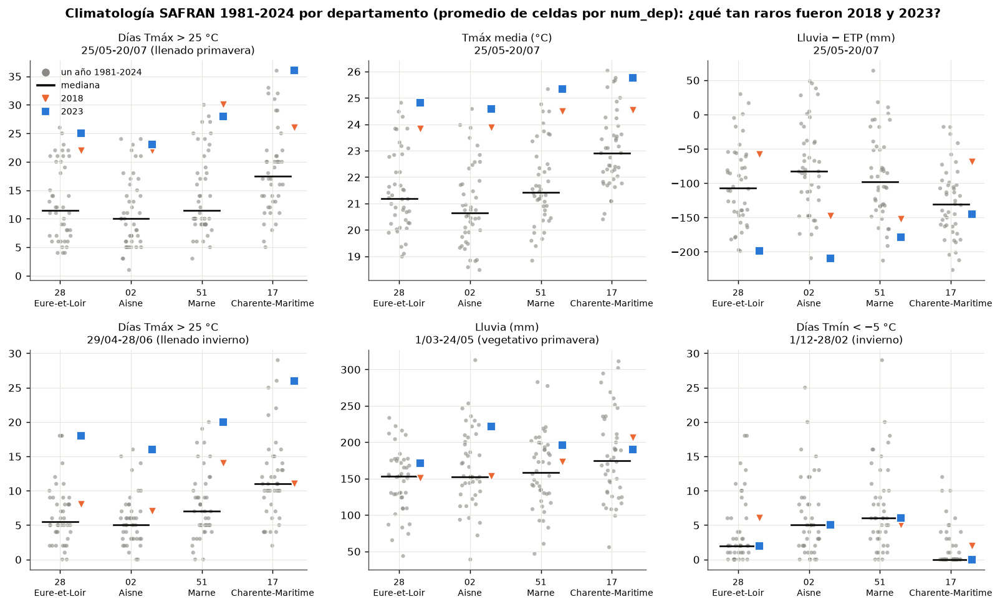

**What it shows:** 44 years of indices over fixed calendar windows, using the mean of the cells of the département (`num_dep`), for 28, 02, 51 and 17. The percentile is computed over 1981-2024 [V].

**Days > 25 °C, 25/05-20/07 (spring filling):**

| Dept | 2018 | 2023 | Median |
|---|---|---|---|
| 28 | 22 (p93) | 25 (p98) | 11.5 |
| 02 | 22 (p93) | 23 (p95) | 10 |
| 51 | **30 (the 44-year maximum)** | 28 (p98) | 11.5 |
| 17 | 26 (p84) | **36 (maximum)** | 17.5 |

**Mean Tmax in the same window:** 2023 is the **44-year record** in 28 (24.8 °C), 02 (24.6) and 51 (25.3).

**Rain − PET in the same window:**
- 2023 is the **driest of the 44 years** in 28 (−199 mm) and 02 (−209 mm).
- 2018 was normal or wet in 28 (−58 mm, p77) and 17 (−69 mm, p89), but dry in 02 and 51 (p23 and p16).

**Days > 25 °C, 29/04-28/06 (winter filling):**
- 2023 is the maximum in 28, 02 and 51 (18, 16 and 20 days against medians of 5.5, 5 and 7);
- 2018 is moderate (p59-p86).

**Spring rain and winter frost:** nothing unusual in either year (percentiles 43-84).

**Why it matters:** **2023 is an extreme year of heat and drought during filling, in all the key départements**. 2018 was hot but not dry in the west. For the demo, 2023 sits at the edge of the climatology, so any model will be extrapolating there.

### 14. Long series 1981-2024 of the filling signals
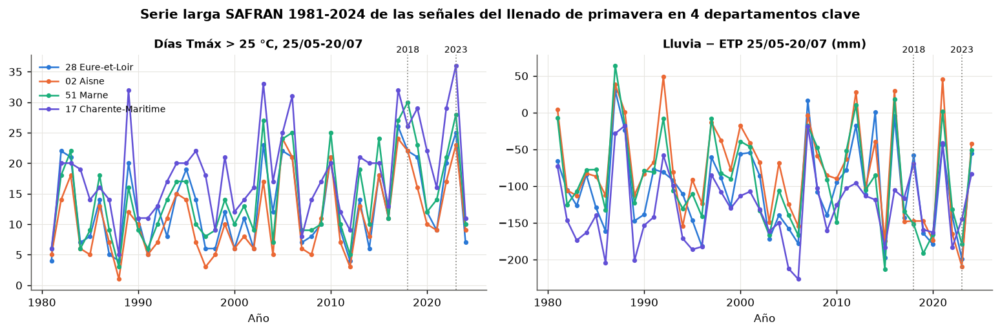

**What it shows:** days > 25 °C and rain − PET between 25/05 and 20/07, year by year, in the 4 départements [V].

**Days > 25 °C, mean 1981-2000 vs 2005-2024:**

| Dept | 1981-2000 | 2005-2024 |
|---|---|---|
| 28 | 11.0 | 14.6 |
| 02 | 8.7 | 13.9 |
| 51 | 11.6 | 17.3 |
| 17 | 16.0 | 20.6 |

- **Linear trend: between +1.2 and +2.2 days per decade** in the 8 départements processed.
- Rain − PET: Aisne goes from −63 to −91 mm and Marne from −74 to −102 mm; Eure-et-Loir and Charente-Maritime stay stable.

**Why it matters:** the climatology is **not stationary**. To generate scenarios, using 1981-2024 evenly underestimates the current heat. It is better to weight recent years or to use 1995-2024 [NV, design decision].

### 15. Climate fingerprint of the demo years
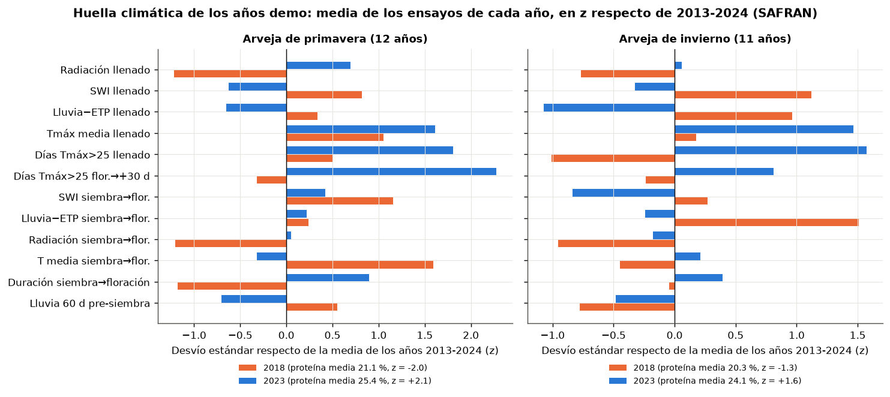

**What it shows:** the mean of each year's trials in z, relative to 2013-2024 (SAFRAN), over 12 indices [V].

**Spring 2018 (protein 21.1%, z −2.0):**
- late sowing: median 22/03 against 18/02 in 2023, with the same flowering (~26/05);
- short vegetative cycle: 71 vs 87 days, z −1.2;
- high mean vegetative T: z +1.6;
- **low radiation** in vegetative (z −1.2) and in filling (z −1.2);
- wet soil: vegetative SWI z +1.2, filling SWI z +0.8;
- early filling heat normal: z −0.3.

**Spring 2023 (protein 25.4%, z +2.1):**
- early filling heat: z +2.3;
- full filling heat: z +1.8;
- dry filling: rain − PET z −0.7, SWI z −0.6.

**Winter 2018:**
- very wet vegetative: rain − PET z +1.5;
- wet filling: SWI z +1.1;
- low filling heat days: z −1.0.

**Winter 2023:**
- filling heat days: z +1.6;
- rain − PET: z −1.1.

**Why it matters:** the two demo years separate by **water (excess in 2018, deficit in 2023), radiation and cycle length**, not only by heat. That also explains the difference with plot 13: in the 2018 spring trials, the calendar heat fell after early filling.

---

## 2. Key findings

1. **The climate → protein signals at trial level are weak.** No Spearman |ρ| exceeds 0.27 for protein or 0.34 for yield, over 17 indices × 4 crossings (plot 08) [V].
2. **Heat and drought during filling go with *more* protein, not less.** Filling days > 25 °C: ρ +0.27 for winter and +0.12 for spring. In early spring filling, ρ +0.24 with days > 25 °C and −0.22 with rain − PET. On spring yield the sign is the opposite (early Tmax −0.30): **dilution / concentration** [V].
3. **The year effect confounds.** In spring, the heat-protein relation is −0.31 between years and +0.23 within a year. The year explains ~25% (spring) and ~30% (winter) of the variance of mean trial protein [V].
4. **2018 and 2023 were both very hot during spring filling** (p84-p100 in the 4 key départements). What separates them is water:
   - 2023 had the driest water balance of the 44 years in Eure-et-Loir (−199 mm) and Aisne (−209 mm);
   - 2018 was normal or wet in 28 and 17 (p77 and p89), with a wet, dark (radiation z −1.2) and short vegetative period (late sowing, 71 days vs 87) [V].
5. **2023 is a historic extreme:** record mean Tmax 25/05-20/07 in 28, 02 and 51, and record days > 25 °C during winter filling in all three [V]. Filling heat has risen **+1.2 to +2.2 days/decade** since 1981 [V].
6. **The source change is not trivial.** SAFRAN gives Tmax −1.5 °C and **−5.3 days > 25 °C** relative to the dataset climate (r 0.89-0.95), and radiation −130 MJ/m² during filling [V]. Correlations with protein are preserved in sign and order of magnitude.
7. **At D2 most of the filling heat is still missing:** 36% (spring) and 20% (winter) of the days > 25 °C had been seen, even though 83-86% of the calendar had passed [V].
8. **A single climate index does not shrink the spread of protein.** In spring the SD within tertiles stays at 1.97-1.98 at every date; in winter it drops from 1.95 to 1.84 only with full filling [V].
9. **Season totals are not useful** (rain sowing → harvest: ρ ≈ 0); the information is in the phase [V].

---

## 3. Implications for the model

**Promising variables, by decision date**

Short list: I chose them on agronomic grounds and for consistency of sign across types and sources, **not by correlation ranking**. They need to be confirmed with LOYO.

| Date | Variables | Comment |
|---|---|---|
| D0 (contract / sowing) | type, breeder protein class, region; **sowing date** (day of year); rain in the 60 days before sowing | The late sowing of 2018 suggests that the sowing date carries information about a wet winter [NV]. Pre-sowing rain appeared in yield (ρ −0.2/−0.26) |
| D1 (flowering) | sowing → flowering duration; mean T and radiation of the vegetative period; rain − PET and SWI of the vegetative period (excess water, mostly winter); frost < −5 °C (winter) | Signal of a "dark, wet year" like 2018 |
| D2 (flow. + 30 d) | days > 25 °C, mean Tmax and rain − PET of flowering → +30 d; minimum SWI | Best aligned with protein in spring; 64-80% of the filling heat is still missing |
| Rest of filling | same indices over flowering + 30 d → flowering + 55 d, **from scenarios** | Do not anchor on the actual harvest (leakage) |

**How to build them**
- The windows are anchored on **flowering** (date observed at D1) and on a **fixed length** (+30, +55 d). The actual harvest is not used.
- Before D1, flowering is estimated with growing degree-days from sowing. With SAFRAN, the annual means of sowing → flowering degree-days range from 810 to 1,020 °C·d in spring and from 1,070 to 1,260 in winter [V].
- Threshold counts are computed **with the same source** in training and in inference. With SAFRAN, > 25 °C is the threshold with variance; > 30 °C almost never occurs.
- Aggregate at trial level (trial mean) for the environmental part, as the dossier already proposes.

**SAFRAN vs dataset climate: decision**
- **Use SAFRAN for everything:** training, scenarios and operation.
  - It is the only source with a long climatology (44 years processed in ~15 min) and with coverage of any plot or département.
  - It fixes the bad coordinates (AVANCON) without depending on the trial file.
  - The signals are preserved (plot 10).
- The dataset climate stays only as a sensitivity check.
- If sources are mixed, the Tmax bias (−1.5 °C) and the counts must be corrected.

**Scenarios for the rest of the season**
- At D0 and D1: for each historical year h, the season is built from what has been observed up to the cut-off date + the climate of h from the cut-off date to harvest (same cell), and the indices are computed. That gives a distribution of forecasts.
- Weight recent years or trim to 1995-2024, because of the heat trend (plot 14).
- **Exclude the test year from the ensemble** (leakage, already listed in the dossier).
- For 2023, warn in the demo that it sits at the edge of the climatology: a 1981-2022 ensemble has almost no filling periods this hot (record in 3 of 4 départements).

**Traps**
- **Confounding with the year** (plot 09): with 12 years, a variable that separates 2018 from 2023 can "explain" a lot without being causal. Validate with LOYO and look at the signal **within the year**.
- Possible non-climatic trend (varieties, laboratory) coinciding with the recent hot years [NV]. Test a year or varietal-cohort term as a control.
- Opposite signs between protein and yield: a high P(protein ≥ 23) can come from a stress year with low yield (LE_SUBDRAY 2023). Keep both targets or protein per hectare.
- Fixed calendar windows (département) and phenological ones (trial) count different things: 2018 comes out p93 on the calendar but z +0.5 in the phenological filling of the trials.
- SWI can go above 1 (excess). Do not trim it: it is exactly the signal of a wet winter.

---

## 4. Open questions

1. Is the late sowing date a good early proxy for "wet year / low protein" or is it a coincidence of 2018? Check it over 2013-2024 and with agronomist mentors.
2. Why did 2024 have high protein (24.0%) with a cool, wet filling (low heat z)? Is it varietal or laboratory? If so, the underlying trend is a serious confounder.
3. Is the effect of excess water in winter (filling SWI vs yield, ρ −0.34) waterlogging or disease (aphanomyces)? The dataset has no disease data.
4. Is a fixed D2 (15/06) or phenological one (flowering + 30 d) preferable? The phenological one gives the same meaning across types, but the buyer thinks in calendar dates.
5. How much does the gap between the SAFRAN cell and the real plot matter for a buyer who contracts by département? For the product, the département mean weighted by RPG is probably enough (see `datasets/safran.md` §6) [NV].
6. Should the seasonal forecast (Open-Meteo seasonal, see dossier §4.6) be added instead of pure climatology for the remaining stretch? With the heat trend it could help, but it adds complexity.
