# EDA idea 1: farm-field context and the bridge trials → farms → buyer

Prepared on 30/10/2026, before the event. **Descriptive only** (sums, means, CV, ratios, simple correlations, maps). No model was fitted and no results were tuned. The moving average in figure 4 is a visual smoothing, not a model.

Tags: **[V]** computed by me today on the downloaded files; **[F]** read in a source (PDF, dossier, press). **[NV]** my own assumption or approximation.

Sources downloaded (deleted at the end, re-downloaded with the scripts):
- Agreste SAA long series 2010-2025, sheet `COP`, `41 - Pois protéagineux` and `38 - Féveroles et fèves` (Licence Ouverte).
- Agreste SAANR_DEVELOPPE_2 2000-2020 (`1.13.1` pea, `1.13.2` faba), used only for 2000-2009 in the splice and to compare levels.
- Pea_dataset INRAE (doi:10.57745/FW78RE, Etalab 2.0): `trials_data` + `crop_traits_data`.
- RPG: `archive/research/datasets/rpg_pulses_dept_year.csv` (PPR+PHI) plus, new, **PHI** (winter pea) parcels for 2015, 2020 and 2024 via IGN WFS (`code_cultu='PHI'`, centroid → dept). 6,403, 8,034 and 7,196 parcels.
- Terres Inovia / Terres Univia, "Qualité des graines pois" 2019 to 2025 (`qg-pois-<year>.pdf`, `qualite-graines-pois-2025.pdf`). 2015-2018 do not exist under those names (the URL returns HTML).
- Département outlines: `gregoiredavid/france-geojson` (simplified version of ADMIN EXPRESS IGN, INSEE 2018 codes; the README points to the Licence Ouverte of Admin Express [V]; for production use ADMIN EXPRESS directly).

Scripts: `scratchpad/en_ctx/scripts/` (`01_rpg_phi.py`, `02_prep.py`, `03_explore.py`, `04_plots.py`). Small derived CSVs in this folder (see the end).

---

## Figures

### 1. Pea area by département (RPG 2015, 2020, 2024)
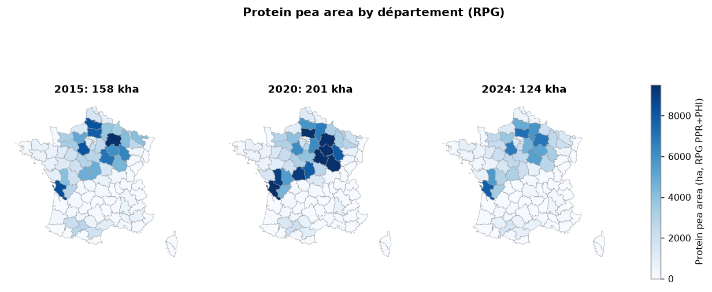

**What it shows:** hectares of protein pea (PPR+PHI) by dept in three years. **Why it matters:** production is concentrated in a north-central crescent (Marne, Aisne, Oise, Eure-et-Loir, Somme, Aube, Yonne) plus Charente-Maritime and Deux-Sèvres to the west. This is the weight to use to go from "trial" to "basin". RPG totals: 158 kha (2015), 201 kha (2020), 124 kha (2024) [V].

### 2. Winter vs spring pea (RPG PHI / PPR+PHI)
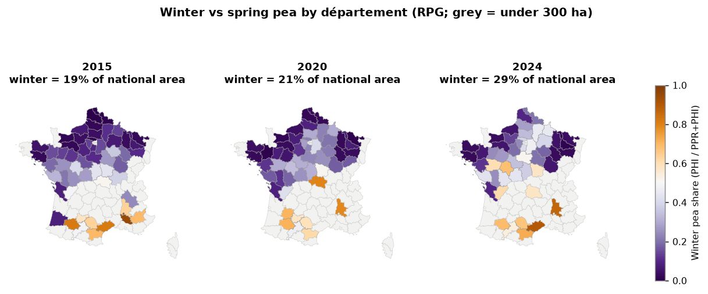

**What it shows:** the fraction of each dept's area sown to winter pea. **Why it matters:** winter went from **19% (2015) to 21% (2020) and 29% (2024)** of national area [V]. The jump is in the north: Aisne 11% → 22% → **46%**, Loiret 10 → 51%, Seine-et-Marne 14 → 47%, Marne 7 → 39%, Oise 4 → 33%, Somme 2 → 28% [V]. In trials winter gives ~1 point less protein (Pea4Ever exists for that reason [F]), so **the varietal mix of the Roquette basin is moving right toward the type with less protein**. The model has to predict by type, and the basin is built by weighting with this fraction.

### 3. Trials over the 2024 area
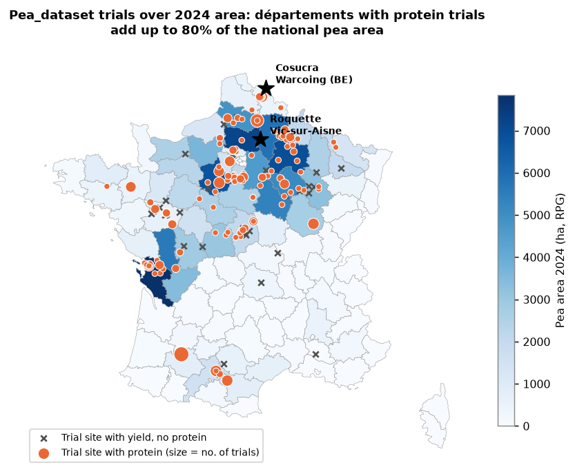

**What it shows:** the 158 Pea_dataset sites (118 with protein) over the 2024 area. **Why it matters:** the départements with at least one protein trial add up to **80% of the 2024 national area** (87% if any trial is counted) [V]. Of the top 20 départements by area, only **Charente (16), Calvados (14) and Meuse (55)** have no protein trial at all [V]. But coverage is not density: **Oise (60), the country's second-largest dept (7,200 ha), has only 1 protein trial**, and Yonne (89, 5,400 ha) has 2 [V]. Aisne has 9 protein trials in 2003-2024 [V].

### 4. National series 2000-2025
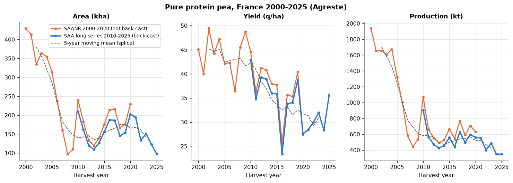

**What it shows:** national area, yield and production of pure pea, with the two Agreste sources overlaid. **Why it matters:** (a) area fell from 429 kha (2000) to 98 kha (2025) and production from 1.94 Mt to 0.35 Mt [V]; (b) yield dropped from ~45 q/ha in the 2000s to ~30 in the 2020s (moving average) with a lot of noise: national CV 2010-2025 of **15%** [V]; (c) **the two sources do not agree in 2010-2020**: SAANR (not back-cast) gives ~12% more area than the SAA long series (2010: 239.5 vs 210.0 kha; 2020: 229.5 vs 202.7) and 1-2 q/ha more yield [V]. For any calculation use the 2010-2025 long series; the 2000-2009 data only serves as context for the level.

### 5. Yield variability by dept (CV 2010-2025)
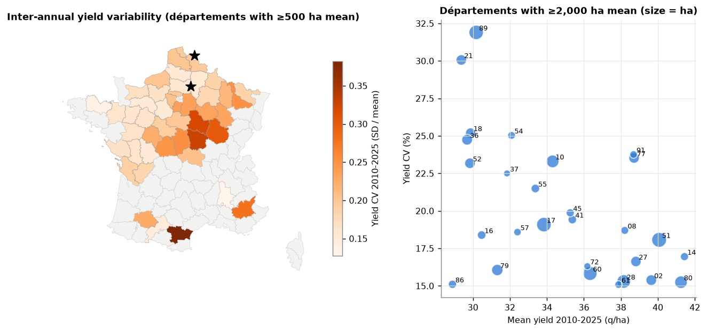

**What it shows:** the SAA yield CV by dept (départements with ≥500 ha mean and ≥6 years; Oise only 2020-2025 because of the series artifact). **Why it matters:** median **19%** [V]. The north (Aisne 15%, Somme 15%, Eure-et-Loir 15%, Oise 16%, Marne 18%) is both the highest-yielding (38-41 q/ha) and the most stable; the Burgundy-Berry arc (Yonne 32%, Côte-d'Or 30%, Cher 25%, Indre 25%) yields ~30 q/ha and is twice as volatile [V]. For a buyer this is volume risk per contracted hectare, separate from protein risk.

### 6. The trial-farm field yield gap
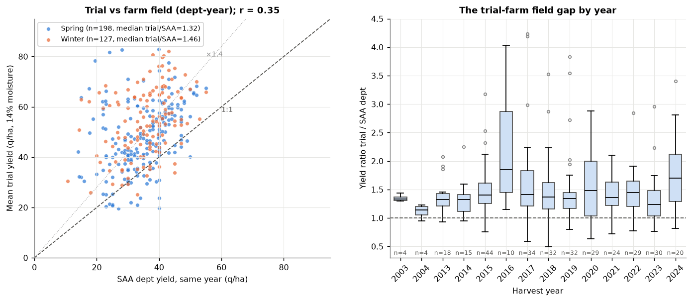

**What it shows:** mean yield of each trial (site × year × type) against the SAA yield of the same dept and year (325 pairs). **Why it matters:** the trial yields a median **1.36 times** the farm field (IQR 1.18 to 1.65; spring 1.32, winter 1.46) [V]. The trial-dept correlation is **r = 0.35** at trial level and 0.34 after removing each dept's mean, but it rises to **r = 0.81 between annual means** [V]. In plain terms: a single trial says little about its dept's yield, but the average of a year's trials does follow the national year. The ratio also changes by year (1.24 in 2023, 1.70 in 2024, 1.85 in 2016) [V]: in bad years the farm field falls more than the trial. **Do not use trial yield in q/ha as a prediction for the farm field.**

### 7. Trial protein vs the national series
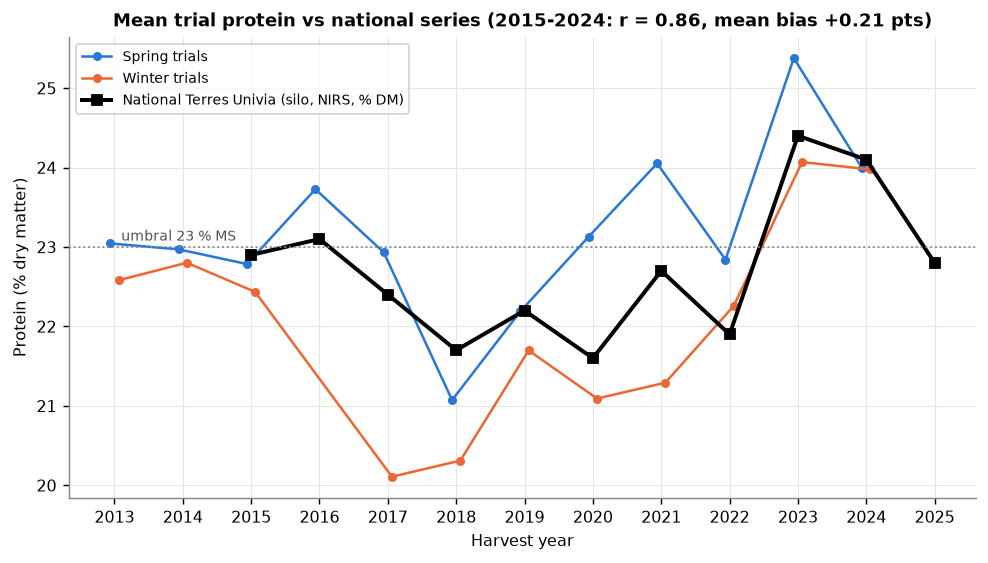

**What it shows:** the annual mean protein of the trials (by type) and the Terres Univia national series (silo, NIRS, % DM, 2015-2025). **Why it matters:** trial mean vs national 2015-2024: **r = 0.86 and mean bias +0.21 points** [V]; annual differences range from -0.82 (2018) to +1.08 (2020) [V]. Unlike yield, **trial protein does sit on the farm-field scale**. Winter is below spring in almost every year (2017: 20.1 vs 22.9; 2020: 21.1 vs 23.1) [V], and the national series falls between the two, as expected for a ~20-30% winter mix.

### 8. Protein by Terres Inovia basin 2019-2025
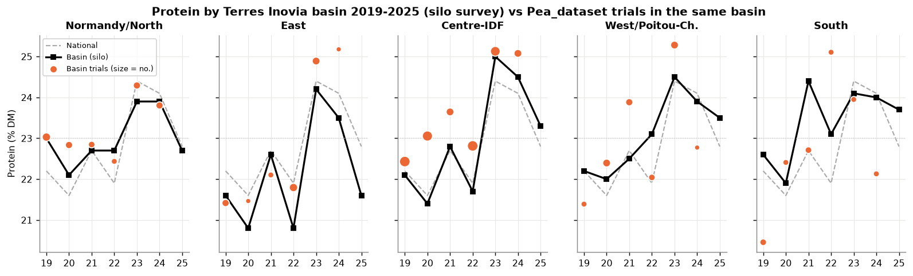

**What it shows:** the 35 basin × year means transcribed from the PDF maps [F, my transcription checked against the text] and, on top, the mean of the Pea_dataset trials in the same basin (approximate dept → basin mapping, [NV]). **Why it matters:**
- The year matters more than the basin: deviation of the annual mean between years is 0.96 points vs 0.64 between basins within the same year [V]. The range between basins in one year goes from 1.0 (2024) to 2.3 points (2022) [V].
- **East** is systematically the low basin (20.8 in 2020 and 2022, 21.6 in 2025); **Normandy/North** (the Roquette basin) is the most stable (22.1 to 23.9) and did not have the 25% peak of 2023 [V].
- Trials vs basin, 30 basin-year pairs: **r = 0.66, bias +0.17, mean absolute error 0.83 points** [V]. This is the regional external validation available; in Normandy/North the trials land almost on top of the basin.
- Caution: in 2024 the sum of "n" per basin is 93 but the text says 75 samples [F]; the national means are weighted by regional production [F].

### 9. What moves protein tonnage
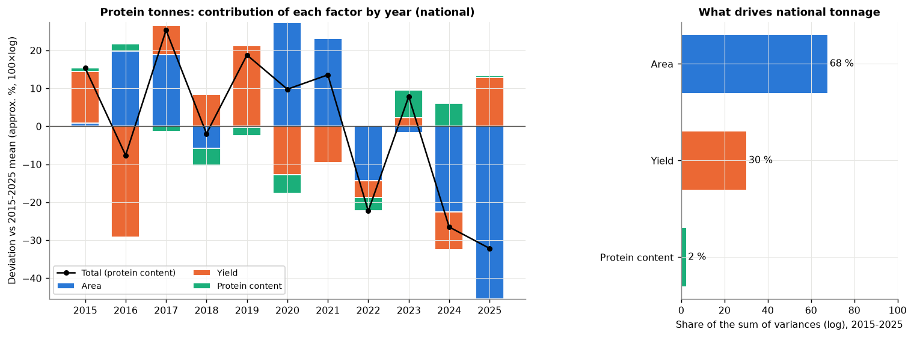

**What it shows:** national protein content = area × yield × 0.86 DM [NV] × protein, in log and deviation from the 2015-2025 mean. **Why it matters:** the sum of variances splits **68% area, 30% yield, 2% protein content** [V] (confirms 6_radar). Protein content: from 121 kt (2017) to 68 kt (2025) [V]. At national scale protein content barely moves the tonnage; what moves it is how much is sown. For the product: protein matters **per processed tonne** (extraction yield, lot value) and **for segregation**, not for national volume.

### 10. Roquette and Cosucra basins
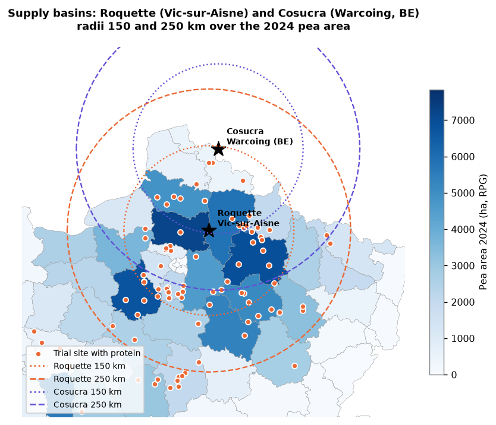

**What it shows:** 150 and 250 km radii around Vic-sur-Aisne (Roquette) and Warcoing (Cosucra, Belgium) over the 2024 French area. **Why it matters:** with départements assigned by their representative point [V]:

| Radius | Roquette: FR area 2024 | % national | % of that area in départements with protein trials | Cosucra: FR area 2024 | % national |
|---|---|---|---|---|---|
| 150 km | 42.1 kha | 34% | 100% | 13.8 kha | 11% |
| 200 km | 64.2 kha | 52% | 94% | 21.8 kha | 18% |
| 250 km | 79.7 kha | 64% | 89% | 42.2 kha | 34% |

Roquette contracts within a 250-300 km radius [F, dossier §2]: **two thirds of French pea are in its basin**. For Cosucra the Belgian side is missing (RPG covers France only); French pea exports to Belgium (animal feed and ingredients) fell from 127 kt (2018/19) and 95-105 kt (2020/21 to 2023/24) to **55 kt in 2024/25 and 55 kt forecast for 2025/26** [F, Terres Univia balance sheets from the PDFs].

### 11. Roquette basin, dept by dept
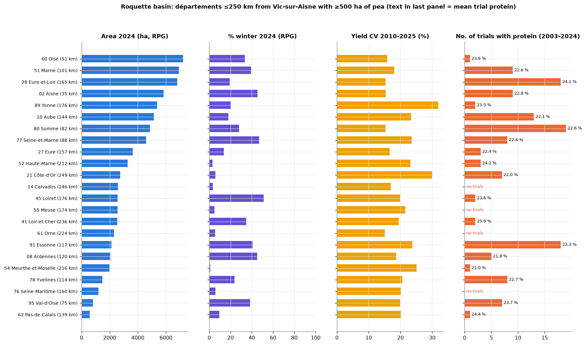

**What it shows:** the 23 départements within ≤250 km of Vic-sur-Aisne with ≥500 ha: area, % winter, yield CV and number of protein trials (with their mean). **Why it matters:** this is the demo table. The four large nearby ones (Oise 51 km, Aisne 35, Marne 101, Somme 82) have CV 15-18% and 28-46% winter; Eure-et-Loir and Somme are the best covered (18-19 protein trials); **Oise (1 trial), Yonne (2), Calvados, Meuse, Orne and Seine-Maritime (0)** are gaps [V]. Within the basin, the protein situations (1,717 measurements) go from 28% ≥23% DM in 2022 to 96-97% in 2023-2024 [V]; the trial/farm-field yield gap is 1.34 (spring 1.30, winter 1.40) [V], the same as the national one.

### 12. Contrast with faba bean
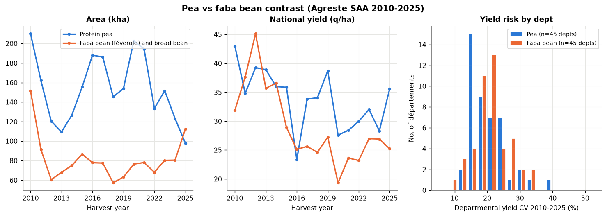

**What it shows:** national pea area and yield vs faba bean (féverole and fèves), and the distribution of the departmental CV. **Why it matters:** in **2025 faba bean (112 kha) overtook pure pea (98 kha)** for the first time in the series [V]. Faba yield is more volatile at national level (CV 23% vs 15%) and similar by dept (median 21% vs 19%) [V]. It works as an argument that "the method extends to other pulses", and as context: pea is losing area to another protein crop, not only to wheat.

---

## Key findings

1. **Trial yield is not farm-field yield:** median 1.36× the SAA of the dept-year (325 pairs, IQR 1.18-1.65), r = 0.35 per trial [V]. But annual trial means follow the year (r = 0.81) [V]. → yield **relative** to the dept, never in q/ha.
2. **Trial protein does sit on the farm-field scale:** r = 0.86 with the 2015-2024 national series, bias +0.21 points [V]; r = 0.66 and mean error 0.83 points against the 2019-2024 basin means [V].
3. **The year dominates the region for protein:** 0.96 points of deviation between years vs 0.64 between basins [V]; East is the recurrent low basin, Normandy/North the stable one [F/V].
4. **Winter grows fast in the Roquette basin:** 19% → 29% of national area 2015-2024; Aisne 11% → 46% [V]. Winter has ~1 point less protein in trials [F, dossier].
5. **Two thirds of French pea area (79.7 kha, 64%) lies within ≤250 km of Vic-sur-Aisne**, and 89% of that area is in départements with protein trials [V]. Gaps: Oise (the country's 2nd-largest dept, 1 trial), Yonne, Calvados, Meuse, Orne, Seine-Maritime [V].
6. **The north yields more and is more stable** (CV 15-18%, 38-41 q/ha) than Burgundy-Berry (CV 25-32%, ~30 q/ha) [V].
7. **At national scale protein tonnage is driven by area (68%) and yield (30%), not by content (2%)** [V]. From 121 kt (2017) to 68 kt (2025) [V].
8. **The two Agreste series differ by ~12% in area in 2010-2020** [V]: use the back-cast long series and do not mix them.
9. **The market is shrinking:** pure pea area 98 kha in 2025, overtaken by faba bean (112 kha) [V]; exports to Belgium halved (55 kt in 2024/25) [F].
10. **"Fit for human consumption" has no series:** only ~80% (2024) and ~60% (2025) quantified; declared human destination 7% (2022), ~25% (2023), 12% (2024), 9.5% (2025) [F, PDF]. What is in all the sheets: "alimentation humaine et ingrédients" 140-150 kt/year, flat [F].

## Implications for the product and the model

- **Prediction unit:** trial (site × year × type), with two outputs: protein in % DM (absolute level, transferable) and **relative** yield (index or anomaly versus the dept mean). Never trial q/ha as farm-field q/ha.
- **From trial to buyer's basin:**
  1. Predict protein by dept × type (winter/spring) with that dept's SAFRAN climate.
  2. Aggregate to the basin weighting by **RPG area of the latest available year × winter share** (`rpg_winter_share_dept.csv`), and in season replace the area with the month's Agreste note (6_radar).
  3. For yield: `farm_yield = SAA_mean_dept_yield × predicted relative index`; the dept's historical CV (`saa_yield_cv_dept_2010_2025.csv`) gives the reasonable minimum width.
  4. **Level calibration:** compare the predicted weighted national mean with the Terres Univia series (11 years) and by basin with the 35 means 2019-2025. With a mean bias of +0.2 points a simple shift is enough; do not adjust anything on the test year (leakage).
  5. Basin protein tonnage = area × yield × 0.86 × protein, by Monte Carlo, showing which part of the uncertainty is area (which the buyer controls with contracts) and which part is climate.
- **Départements for the demo:** Roquette basin ≤250 km. Core: **Aisne (02), Marne (51), Somme (80), Eure-et-Loir (28)** (large area, good coverage, 9-19 protein trials). **Oise (60)** as the honest case of "lots of area, almost no trials": the model has to lean on neighbours (02, 80, 95). Contrast outside the north: **Charente-Maritime (17)**, the country's 1st dept with 18 trials. For Cosucra: Nord, Pas-de-Calais, Somme, Aisne, plus the warning that Belgium is missing.
- **Honest message for the pitch:** (a) the value lies in protein per tonne and in segregation, not in national volume (2%); (b) in the basin, the risk the buyer controls is contracted area and the winter/spring mix; (c) the model predicts "trial protein" calibrated to the silo series, with a typical error of ±0.8 points already between trials and basins before modelling anything.
- **Caveats:** approximate dept → basin mapping [NV]; site coordinates with errors (AVANCON corrected to 08, GRIGNON to 78; DIOU and GRIGNON_INRAE left as is); Oise has no SAA yield before 2020; SAA 2025 provisional; RPG covers France only; the radius-based basin from the dept centroid is an approximation of real logistics; 0.86 DM is an assumption.

## Open questions

1. Do Roquette and Cosucra measure protein on receipt by lot and dept? With one year of plant NIRS the basin level could really be calibrated (question for mentors).
2. Does the winter protein drop persist with the new varieties, or is it an effect of few sites? (in 2023-2024 trials the gap nearly disappears: 24.1 vs 25.4 and 24.0 vs 24.0 [V]).
3. What weight should a dept without trials get (Oise, Calvados)? Nearest neighbour, its own SAFRAN climate with an average site effect, or exclude it and say so?
4. What is Cosucra's real basin in France (Hauts-de-France only) and how much does it buy in Belgium? The Belgian data (Statbel) is missing to close that map.
5. What are the exact limits of the 5 Terres Inovia basins? Today they are approximate, read from the PDF map.
6. Why does the trial/farm-field ratio spike in bad years (2016, 2024)? If it is systematic, the trial's relative yield understates the farm-field drop and must be corrected with the SAA series.

## Derived files in this folder (exploratory, < 2 MB)

- `rpg_winter_share_dept.csv`: year × dept, PPR+PHI area, PHI area, winter share (2015, 2020, 2024).
- `saa_yield_cv_dept_2010_2025.csv`: mean area, mean yield, SD, CV by dept.
- `trial_vs_saa_gap_dept_year.csv`: trial × SAA yield of the dept-year and ratio.
- `terres_inovia_protein_basin_2019_2025.csv`: the 35 basin × year means with number of samples.
- `dept_to_basin_approx.csv`: dept → basin (approximate; the ones not listed are South).
- `roquette_basin_250km.csv`: depts within ≤250 km of Vic-sur-Aisne with area, winter, CV, trials and mean protein.
