# EDA idea 1: Pea_dataset (trials and crop traits)

Exploratory analysis done on 2026-10-30 on the INRAE Pea_dataset (doi 10.57745/FW78RE, version 1), only `trials_data`, `crop_traits_data` and `metadata` (climate is looked at by another agent). **No models trained, no splits, no cross-validation**: only descriptive statistics, group means, a descriptive decomposition of sums of squares and Spearman correlations as exploration.

- Tags: **[V]** = I calculated it myself with the data in this EDA; [F] = comes from the previous audit (`../../../idea1_pea_protein_data.md`) or from a source; [NV] = my own inference.
- Data downloaded with the dossier commands and **deleted at the end**. The scripts (`load.py`, `explore.py`, `plots.py`) are left in `scripts/` next to this file. To reproduce: download the 3 files plus the départements GeoJSON (`gregoiredavid/france-geojson`, `departements-version-simplifiee.geojson`) into an empty directory and run `uv run --with pandas,matplotlib,seaborn,numpy,scipy python -I plots.py <data_dir> <scripts_dir> <out_dir>`.
- Analysis window: harvest years **2013-2024** (the only ones with protein in volume). "Trial" = site-year×type (spring/winter). The management modalities `__Mk` are pooled within the trial.
- Corrections applied before plotting: harvest date of `LE_RHEU__Genotype_58__2013__M1` moved from 2017-07-16 to 2013-07-16 [V the error, NV the correction]; GRIGNON and GRIGNON_INRAE assigned to département 78 for the region [NV].

---

## 1. Protein by year and type

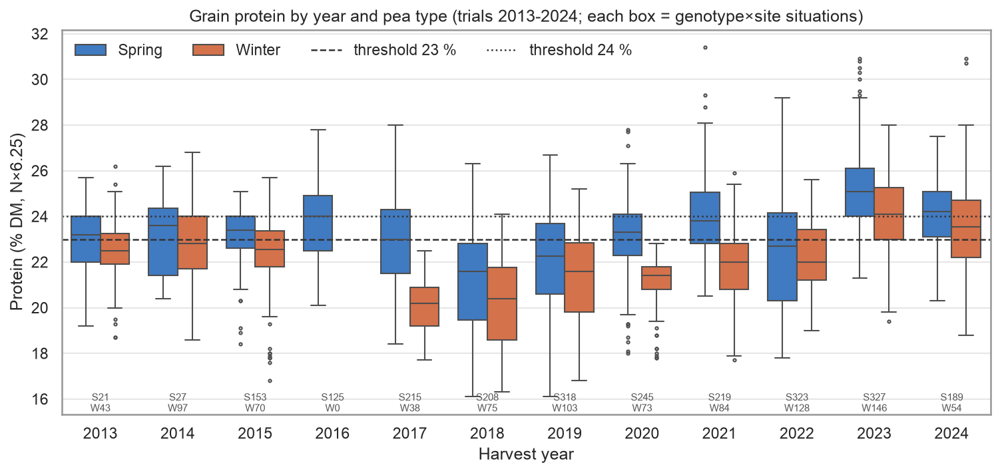

**What it shows.** The protein distribution (% DM) of all genotype×site situations, by year and type, with the 23% and 24% lines. Below, n by type (S = spring, W = winter).

**Why it matters.** The year moves the whole distribution: the spring mean goes from 21.1% (2018) to 25.2% (2023), the winter mean from 20.1% (2017 and 2018) to 24.0% (2023) [V]. The share of situations ≥ 23% goes from 0% (winter 2017 and 2020) to 93% (spring 2023) [V]. Overall, 52% of situations exceed 23% and 33% exceed 24% [V]: the 23% threshold splits the sample almost in half, a good binary target. Winter is below spring in 11 of the 11 years with both types [V].

## 2. Yield by year and type

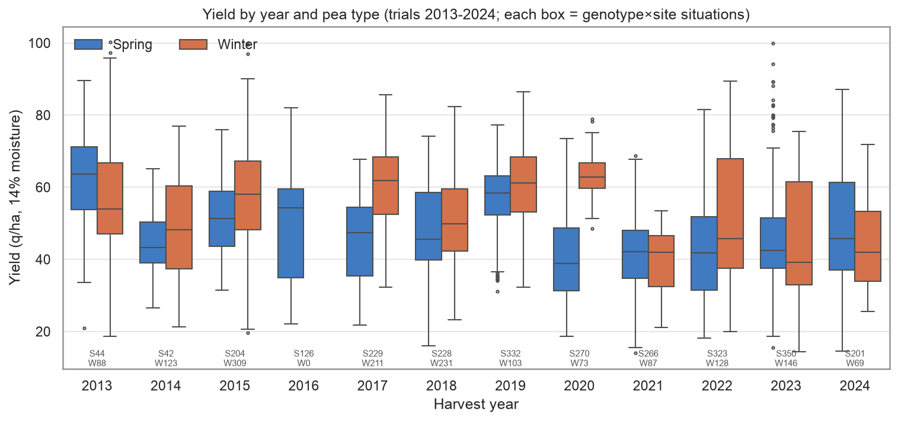

**What it shows.** Yield (q/ha at 14%) by year and type.

**Why it matters.** The ranking of years for yield is **not** the same as for protein: 2023, the best protein year, yielded 44.6 q/ha in spring, one of the lowest; winter 2020 yielded 63.0 q/ha with 21.1% protein [V]. Winter yields more than spring in 8 of 11 years; within the same site-year, winter yields +6.0 q/ha on average (40 site-years with both) [V]. Protein and yield have to be modeled as two outputs, not one.

## 3. Between trials: protein vs yield

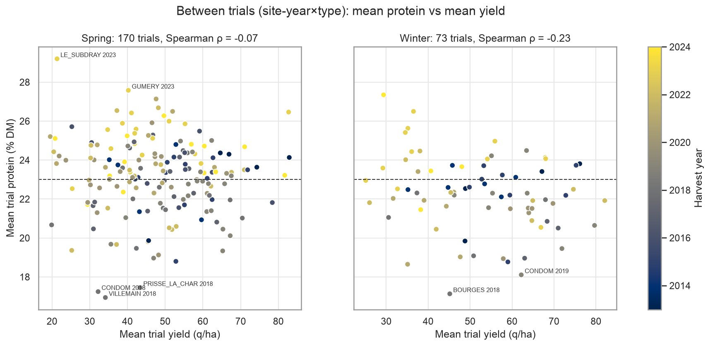

**What it shows.** Each point is a trial (mean of its genotypes), color = year.

**Why it matters.** At trial level there is almost no relationship: Spearman ρ = -0.07 in spring (170 trials) and -0.23 in winter (73) [V]. The extremes of high protein are low-yielding (LE_SUBDRAY 2023: 29.2% and 21 q/ha; GUMERY 2023: 27.6%), so **high protein can be a sign of stress** (few grains), not of a good season. For the buyer, the useful product is "protein × yield" (tonnes of protein), not protein alone.

## 4. Within the trial: genotypes

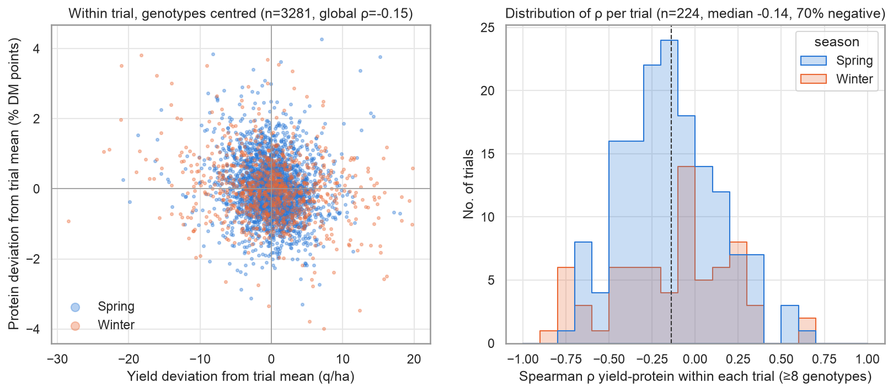

**What it shows.** Left: deviations of each genotype from its trial mean (yield vs protein). Right: the Spearman ρ computed within each trial with ≥ 8 genotypes.

**Why it matters.** Within a trial there is a weak trade-off: global ρ of the deviations -0.15 (3,281 situations), median per trial -0.14, 70% of the 224 trials with negative ρ [V] (more marked in spring, median -0.16, than in winter, -0.07). The dilution of protein by yield exists but is small: choosing a high-protein genotype costs little yield.

## 5. Variance decomposition

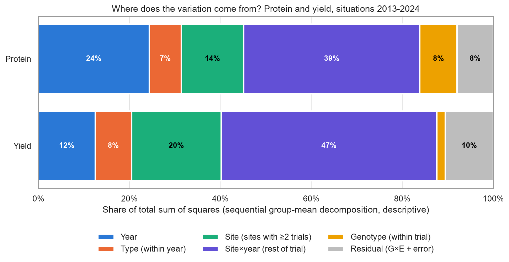

**What it shows.** Share of the total sum of squares explained by sequential group means: year → type within year → site (mean site effect, only identifiable for sites with ≥ 2 trials) → rest of the trial (site×year) → genotype (mean genotype deviation from the trial mean) → residual. It is descriptive, not an ANOVA with a test.

**Why it matters.** [V]

| Component | Protein | Yield |
|---|---|---|
| Year | 24% | 12% |
| Type within year | 7% | 8% |
| Site (repeated) | 14% | 20% |
| Site×year (rest of the trial) | 39% | 47% |
| Genotype within the trial | 8% | 2% |
| Residual (G×E + error) | 8% | 10% |

**The environment (year + site + site×year + type) explains ~84% of the variation in protein and ~88% of that in yield.** The genotype explains 8% of protein and almost nothing of yield. The largest block is site×year: it is what the season's climate has to explain. Caveat: the 14% of "site" mixes soil, region and management, and since 100 of 150 sites appear for only one year, part of the site effect ended up inside site×year.

## 6. Genotype × environment (heatmap)

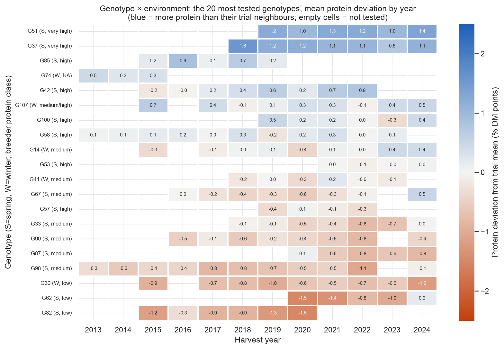

**What it shows.** For the 20 genotypes with the most situations with protein, the mean deviation from the trial mean, by year. Label: type and breeder protein class.

**Why it matters.** The deviations are very stable in sign: G51 and G37 (spring, "very high") are +0.8 to +1.6 points every year; G82, G30, G62 ("low") between -0.5 and -1.5 almost always [V]. Among the 80 genotypes with ≥ 10 trials, the median sign consistency is 81% and the mean deviation goes from -1.3 to +2.4 points [V]. G×E exists but is small compared with the main effect: **the genotype can be treated as an additive offset** on top of the environment prediction.

## 7. Stability of the genotype ranking

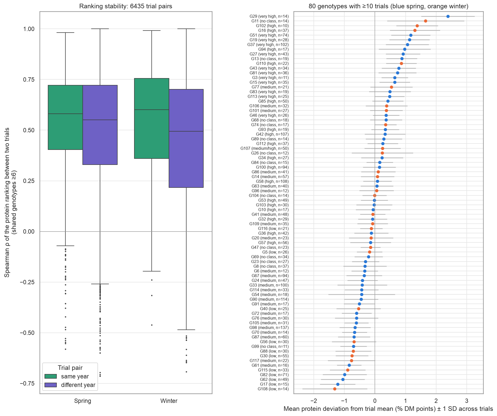

**What it shows.** Left: Spearman of the protein order of shared genotypes (≥ 6) between pairs of trials of the same type, separating pairs from the same year and from different years (6,435 pairs). Right: mean deviation ± 1 SD of the 80 genotypes with ≥ 10 trials.

**Why it matters.** The ranking is moderately preserved: median ρ 0.58 (same year) and 0.55 (different year) in spring; 0.60 and 0.49 in winter [V]. That the value across years almost equals the one within the same year indicates that the genotype order does not depend much on the season. The typical SD of a genotype's deviation across trials is 0.56 points [V], the noise to expect at genotype level.

## 8. Breeder protein class vs measured protein

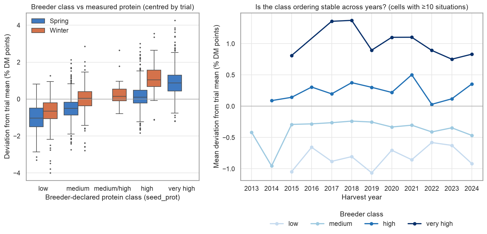

**What it shows.** Left: deviation from the trial mean by the `seed_prot` class, by type. Right: mean deviation by class and year (cells with ≥ 10 situations).

**Why it matters.** The class orders well and the order is stable every year: low -0.81, medium -0.34, high +0.25, very high +0.93 points [V]; raw 21.9 / 22.5 / 23.2 / 24.5% [V]. The distance "very high" vs "low" ≈ 1.7 points, the same order as the SD between trials (2.0): the genotype matters, but less than where and when it is sown. **Gotcha [V]:** the class scale is relative to the type. In winter, "high" gives +1.14 and "medium" -0.01; in spring "high" gives +0.14 and "medium" -0.50. There is no "very high" in winter. The class has to enter **crossed with the type**. 11% of the situations with protein have no class (mostly 2013-2015).

## 9. Site map

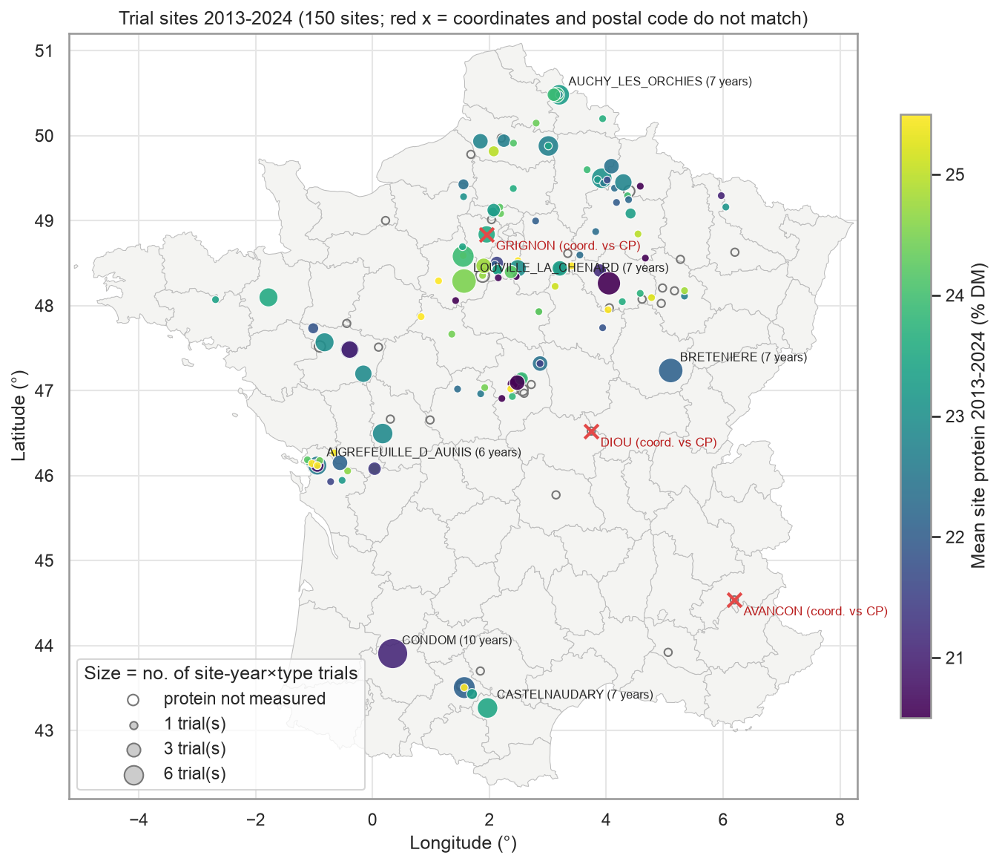

**What it shows.** The 150 sites with trials 2013-2024 over the départements; size = number of trials, color = site mean protein, empty circles = sites without measured protein, red x = sites whose coordinate falls in a different département from the one in the postal code.

**Why it matters.** The network covers the northern half (Hauts-de-France, Île-de-France, Centre, Grand Est), Poitou-Charentes and the Toulouse corridor, and almost nothing of the southeast or Brittany. **100 of 150 sites appear in only one year**, and only 8 appear in ≥ 6 years (CONDOM has 10) [V]: the site effect cannot be learned site by site, it has to go through soil, region and climate. Coordinate check with point-in-polygon against the départements [V]: AVANCON (postal code 08, falls in 05), DIOU (postal code 36, falls in 03), GRIGNON (postal code 73, falls in 78: the postal code is the wrong one), GRIGNON_INRAE (postal code 73, falls in 28), ANGERS_JAILLIERE (postal code 49, falls in 44, at the border). Confirms the H7 list from the plan.

## 10. Flowering vs protein and yield

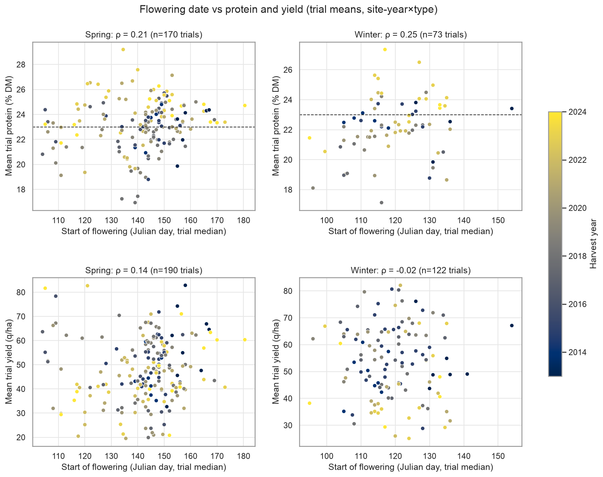

**What it shows.** Median start-of-flowering date of the trial (Julian day) vs mean protein and mean yield.

**Why it matters.** A weak, positive relationship with protein: ρ = 0.21 in spring and 0.25 in winter; with yield 0.14 and -0.02 [V]. Within the trial, the genotype that flowers later than its neighbors has barely more protein (ρ 0.15 spring, 0.10 winter) [V]. The flowering date alone is not enough; what matters is **which climate falls after** flowering (grain filling), and that date is the natural anchor for the climate windows at D1/D2. Part of the correlation may come from the year (recent years) [NV].

## 11. Calendar and sowing date

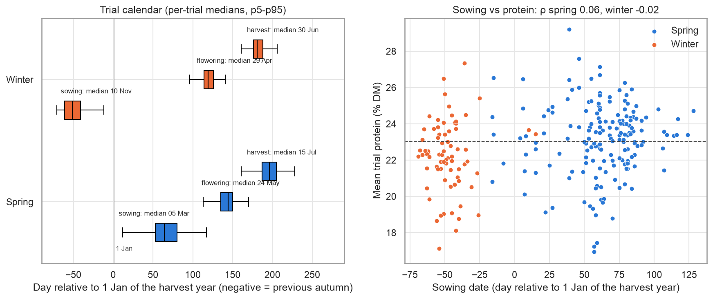

**What it shows.** Left: sowing, flowering and harvest by type (per-trial medians, p5-p95). Right: trial sowing date vs trial protein.

**Why it matters.** Calendar [V]: winter sowing ~10/11 (p5-p95: 26/10 to 6/12), flowering ~29/04 and harvest ~30/06; spring sowing ~5/03, flowering ~24/05, harvest ~15/07. Spring flowers ~25 days later and fills grain at the start of summer. This fixes the flowering decision date D1 of the plan. The sowing date shows no relationship with protein (ρ 0.06 spring, -0.02 winter) [V]: not worth it as a strong feature.

## 12. Missing data by year and variable

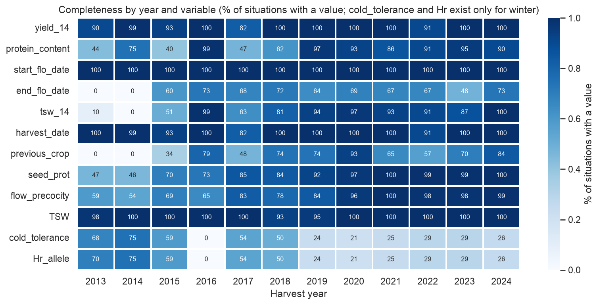

**What it shows.** Percentage of situations with data by year and variable.

**Why it matters.** Protein is largely missing in 2013 (44% present), 2015 (40%), 2017 (47%) and 2018 (62%), and from 2019 onwards it is at ≥ 86% [V]. The missingness is **for the whole site-year**: 195 complete site-years, 65 with no protein at all, 25 partial [V]. `end_flo_date` does not exist in 2013-2014 and a third is missing afterwards; `previous_crop` is missing in 2013-2014 and is irregular; `seed_prot` and `flow_precocity` have gaps in 2013-2016. Implication: old years weigh less, and a feature with missingness by year can leak the year.

## 13. Share of trials ≥ 23% by year, type and region

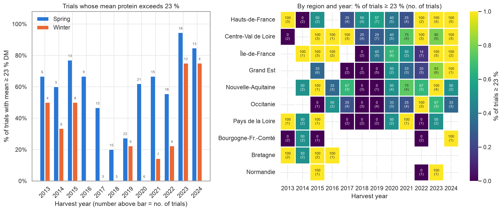

**What it shows.** Percentage of trials (with ≥ 3 genotypes measured) whose mean protein exceeds 23%, by year and type, and by region and year (with the number of trials).

**Why it matters.** By year it goes from 15% (2018) to 87% (2023) [V]. Spring 59% vs winter 34% [V]. By region, with all years together: Centre-Val de Loire 62%, Hauts-de-France 60%, Île-de-France 60%, Nouvelle-Aquitaine 57% vs Grand Est 34% and Occitanie 33% [V]. But most region×year cells have 1 to 5 trials: **a region×type climatology (baseline B0) is estimated from very few points per cell**. At trial level, the year explains 26% of the variation in mean protein, the region 6% and the type 4% [V].

## 14. Outliers by block and irrigation

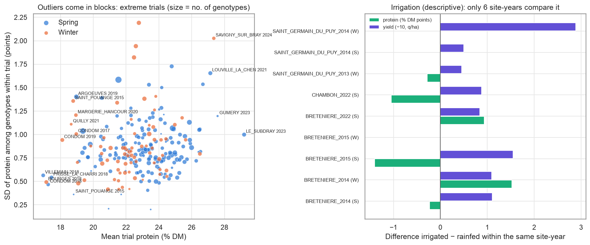

**What it shows.** Left: mean protein vs SD among genotypes within each trial. Right: irrigated minus rainfed difference in the only site-years with both managements.

**Why it matters.** The extremes come **in trial blocks**, not as isolated rows: the 77 situations < 18% are in 13 trials and the 29 > 28% in 6 [V]. The lowest trials are all from 2018 or neighboring years (VILLEMAIN 2018 16.9%, BOURGES 2018 winter 17.1%, CONDOM 2018 17.2%, PRISSE_LA_CHARRIERE 2018 17.4%, CONDOM 2019 winter 18.1%) and have a low within-trial SD (0.5): all genotypes dropped together, a sign of a real environment, **not an error**. We should not remove them: they are exactly the cases the model has to anticipate. Irrigation [V]: 100 irrigated situations in total, comparable only in 6 site-years (BRETENIERE 2014/2015/2022, CHAMBON 2022, SAINT_GERMAIN_DU_PUY 2013/2014). Irrigation raises yield in every case (+0.1 to +28.8 q/ha), but protein moves in both directions (-1.4 to +1.5 points, with small n). Descriptive and anecdotal: irrigation cannot be a model feature; it is better to exclude or flag those situations.

## 15. Trials by year

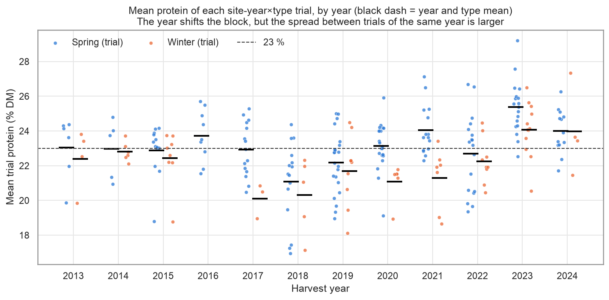

**What it shows.** Mean protein of each trial by year and type, with the annual mean.

**Why it matters.** The annual means have an SD of 1.0 point (from 20.9 in 2018 to 24.9 in 2023), but the SD among trials **within** the same year is 1.7 (median across years) [V]. In other words: knowing the year (which is what the national series gives) is not enough to place a site; most of the risk for a specific contract lies in site×year. In the 23 site-years with both types, winter has 0.8 points less protein than spring (lower in 70% of cases) [V].

---

## Key findings

1. **The environment rules.** Year + type + site + site×year explain ~84% of the sum of squares of protein and ~88% of that of yield; the genotype within the trial, 8% and 2% [V]. SD of the trial mean 2.0 points vs median SD among genotypes within the trial 0.82 [V]; for yield 13.7 vs 3.6 q/ha [V].
2. **The site×year block is the largest** (39% protein, 47% yield) [V]. Within the same year, trials spread with an SD of 1.7 points, more than the annual means among themselves (SD 1.0) [V]. This is where a model with site-level climate can beat "the year mean" or the national series.
3. **Protein and yield barely relate between trials** (ρ -0.07 spring, -0.23 winter) and have a weak trade-off within the trial (median ρ -0.14, 70% of trials negative) [V]. 2023 was the best protein year (24.9%) with low yield; very high protein usually comes with stress (LE_SUBDRAY 2023: 29.2% and 21 q/ha) [V].
4. **The 23% threshold splits the sample in half** (52% of situations, 51% of the 243 trials ≥ 23% in aggregate), but by year it goes from 15% (2018) to 87% (2023) of trials [V]. Spring 59% vs winter 34% [V].
5. **Winter has less protein and more yield**: within the same site-year, -0.8 points of protein (23 cases, 70% lower) and +6.0 q/ha (40 cases) [V].
6. **The genotype is a stable offset**: median sign consistency 81%, deviations from -1.3 to +2.4 points, SD across trials 0.56 [V]; the ranking between pairs of trials has median ρ ~0.55 and hardly drops between different years [V].
7. **The breeder protein class (`seed_prot`) is useful and stable** (low -0.81, medium -0.34, high +0.25, very high +0.93 points relative to the trial, same order every year), but **its scale depends on the type**: winter "high" ≈ +1.1, spring "high" ≈ +0.1 [V].
8. **Flowering and sowing add little on their own**: ρ flowering-protein 0.21/0.25, sowing-protein 0.06/-0.02 [V]. They serve as a time anchor for the climate, not as predictors.
9. **The outliers are environments, not errors**: the 77 situations < 18% fall in 13 trials (2015-2022), 51 of them in only 4 trials from 2018, with low within-trial SD [V].
10. **Confirmed data errors** [V]: 5 sites with a coordinate outside the département of the postal code (AVANCON, DIOU, GRIGNON, GRIGNON_INRAE, ANGERS_JAILLIERE at the border) and the 2017 harvest date of LE_RHEU 2013.
11. **Unstable and little-repeated network**: 100 of 150 sites appear in one year; most region×year cells have 1 to 5 trials; protein is missing for entire site-years in 2013-2018 (65 site-years with nothing) [V].
12. **Irrigation**: 100 situations, comparable only in 6 site-years; always more yield, ambiguous protein [V]. Not usable as a feature.

## Implications for the model

- **Target.** Main: mean trial protein (continuous) and P(protein ≥ 23%) derived from its predictive distribution; 24% as a variant. Secondary: relative trial yield. At product level, the output for the buyer is protein × yield. With 52% of situations ≥ 23%, the binary target is balanced in aggregate but not by year: calibration has to be checked by year.
- **Unit of analysis.** The **site-year×type trial** (~243-248 with protein in 2013-2024, 170 spring and 73 winter) for the environment level; the genotype×trial situation (~3,300) only for the genotype offset. Modeling by row without grouping would inflate the effective n by ~13 times.
- **Architecture suggested by the EDA.** Two levels, as in the plan: (1) trial mean ~ climate by phase + soil + type + region; (2) genotype deviation ~ breeder class **× type** (+ earliness, PMG). The small G×E (residual 8%) justifies treating the genotype as additive.
- **Features the EDA supports.** Type (strong), `seed_prot` class crossed with type, latitude/region (weak alone: 6% between trials), soil by site, climate anchored at the observed flowering (D1) or at typical dates (29/04 winter, 24/05 spring). Flowering and sowing alone: weak. Do not use irrigation or `management`.
- **Baselines to beat.** B0: mean or ≥ 23% rate by type×region in training years (it will be noisy because of the small cells; consider type alone or type×macro-region). B0': the year mean of the type (year oracle, unreachable at D0 but useful to show how much remains in site×year). B1: B0 + class × type offset. The model has to win on the site×year part, which is ~40% of the variation.
- **Pitfalls.** (a) Grouping everything by year in the evaluation (trials of one year share the climate). (b) Protein missingness for entire site-years in 2013-2018: features with gaps by year can leak the year. (c) Do not remove block outliers (2018), they are the signal. (d) Correct the 5 coordinates before extracting climate. (e) `seed_prot` is relative to the type. (f) Normalizing with the test year's means is leakage. (g) Trial yield ≈ 1.5-1.7× the farm field [F]: use it relative. (h) High protein with low yield can be stress: a "good" protein forecast can be bad news in tonnes.

## Open questions

1. Is the protein base in % DM? The annual means match the national series in % DM [F], but the dictionary does not say so.
2. How much of the 39% site×year is explained by climate? This has to be answered by crossing with the climate EDA (heat and water after flowering).
3. Would a coarse region (north/centre/south-west) be better for B0, given that most region×year cells have ≤ 5 trials?
4. What threshold does the buyer actually use (23%, 24%, or a payment range)? It changes the base rate from ~50% to ~33%.
5. What about the winter trials since 2019 (few, 4 to 12 per year)? A common model with type as a feature, or two models?
6. Do sites with shared coordinates (13 groups [F]) count as the same environment for grouping in validation?
7. Are genotypes without a class (11% of situations with protein) imputed with their historical deviation, or left as "no class"?
