# SoyMate (formerly "idea 9"): other image datasets for photo-based quality control of pulses

Date: 30/10/2026. Scope: everything other than the main soybean bruchid dataset (Mendeley d97rjyk2tz, audited by another agent).
Rule respected: **no model was trained or run**. Only downloads, counts, hashes, visual inspection and plots.

Tags: **[V]** verified by me on the data or the open page/API; **[F]** stated by the source and I could not check it in the data; **[NV]** not verified (inference or could not be opened).

Scripts: `scratchpad/cv_other/scripts/` (`audit.py`, `strict_dups.py`, `grid.py`, `overlays.py`, `gsraw.py`, `gs_counts.py`, `mendeley_meta.py`, `mendeley_dl.py`, `remote_zip2.py`, `wv_ann.py`); the copies with English plot labels used to regenerate the PNGs are in `scratchpad/en_other/scripts/`. The downloaded data was deleted afterwards.

## TL;DR

1. **The most important finding for lentil is a Terres Inovia dataset on HuggingFace**: `JeanEudesH/Radio_lentille`, 807 X-rays of **bruchid-infested lentils (lentilles bruchées)** from trials (BRI_21, KAIROL, QAL 2021-2023) + 2 Excel files of counts, MIT, 1.47 GB. It has restricted access ("gated: auto", logging in to HF and accepting is enough). I could not download it because there is no HF token on this machine. [V metadata] It is X-ray, not a phone photo, but it is **French lentil with bruchids** and from Terres Inovia: it is gold for the pitch and for validation.
2. **Multi-grain segmentation and counting by phone**: `SmartFarmingLab/corn1000` (HF, CC BY-NC 4.0): 836 phone photos of 170-1000 grains on A4, 158 with one point per grain + points for **broken** grains and for non-countable objects. It is exactly the "photo of a sample at the cooperative" scenario, but with cereals. [V]
3. **Per-grain defect classification with the best label quality**: **GrainSet** (Scientific Data 2023, CC BY 4.0): 350K grains of wheat/maize/sorghum/rice, 8 damage classes including **AP (attacked by pests, with visible holes)** and **BN (broken)**, plus foreign material. I downloaded GrainSet-tiny (6,580 images) and looked at GrainSet-raw. [V]
4. **Directly on pea**: only 5 photos with 40-542 peas segmented by polygon (Zenodo 21110940, CC BY 4.0); the full set (100) is "on request". It works as a **segmentation test set**, not for training. [V]
5. **Directly on faba bean**: 78 AAFC photos (Zenodo 18226381, CC BY 4.0), 3-10 faba beans per photo on a blue background with a color chart; no damage labels. Useful as unlabeled test photos. [V]
6. What does **not** work or works poorly: WheatVision (massive train/test leakage, unnamed classes), phone soybean 65rzpcgbp4 (the zip **does not include the labels** it promises), CornViT (blurry ~136 px crops), coffee 17 defects (unknown license, ~60 images per class). Roboflow Universe could not be audited (Cloudflare 403 and download requires an account).

## Summary table

| # | Dataset | Crop | Task | Annotation | N images | Classes | License | Useful for | Main problem |
|---|---|---|---|---|---|---|---|---|---|
| 1 | **Radio_lentille** (HF JeanEudesH, Terres Inovia) | lentil | counting bruchid-damaged grains (graines bruchées) in X-rays | per image + Excel of counts [NV contents] | 807 [V] | bruchid yes/no, counts [F] | MIT [V] | (c) and (d): French validation, pitch | Gated; X-ray, not RGB; I did not open it |
| 2 | **corn1000** (HF SmartFarmingLab, U. Leipzig) | oat, barley, wheat, durum, rye | multi-grain counting by phone | exact `count` per photo; 158 photos with points (grain, broken, non-countable) | 836 [V] | count; broken grains and foreign material as points | CC BY-NC 4.0 [V] | (a) counting/segmentation in phone photos | Cereals; NC; points only (no masks); 101 broken-grain points in total |
| 3 | **GrainSet** (Sci. Data 2023, figshare) | wheat, maize, sorghum, rice | per-grain classification + box in raw photo | per-grain label, binary mask per crop, boxes in raw | 352.7K grains [F]; tiny 6,580 [V] | NOR, F&S, SD, MY, AP, BN, BP/HD/UN, IM | CC BY 4.0 [V] | (b) broken, (c) pest hole, foreign material; pretraining | Cereals; industrial camera top+bottom; raw photos of a single class |
| 4 | Pea seed instance seg. demo (Zenodo 21110940) | **pea** | instance segmentation | LabelMe polygons | 5 (of 100) [V] | pea | CC BY 4.0 [V] | (a) and (d): segmentation test on pea | Only 5 images; no defects |
| 5 | Faba Bean Seed Image Dataset (Zenodo 18226381, AAFC) | **faba bean** | phenotyping | none (name = line) | 78 JPG [V] | none | CC BY 4.0 [V] | (d): unlabeled test photos, color/scale calibration | No damage; 3-10 grains per photo |
| 6 | Soybean 6 defects (Mendeley xnx9bfbh6b, IFPI Brazil) | soybean | per-grain classification | folder | 7,328 [F]; API lists 7,100 [V] | good, moldy, burnt, damaged (pecky), scorched, greenish | CC BY 4.0 [V] | (b)/(c) partially, stained/discolored | "damaged" does not show clear holes; fixed blue background |
| 7 | Soybean healthy/damaged by phone (Mendeley 65rzpcgbp4) | soybean | detection | **missing**: the zip has 1,511 JPG and no label files [V] | 1,511 [V] | healthy, damaged [F] | CC BY 4.0 [V] | unlabeled phone photos | The promised labels are not there |
| 8 | WheatVision (Mendeley bx27hg9vwd, VIT Pune) | wheat | grain segmentation + defect region | YOLO polygons, 12 ids **without names** | 4,482 (1,494 originals × 3) [V] | folders healthy, damage, insectdamage (15), staindamage (24), shriveledseed (3)... | CC BY 4.0 [V] | example of annotating the defect region | 956 of 1,494 originals appear in more than one split: leakage |
| 9 | CornViT (Zenodo 17693853) | maize | per-grain classification | folder (3 stages) | 7,265 stage 1 [V] | pure/impure; flat/round; up/down | CC BY 4.0 [V] | (b) very indirect | Blurry ~136 px crops; "impure" mixes everything |
| 10 | Green coffee 17 defects (Kaggle sujitraarw) | coffee | per-grain classification | folder | 979 [V] | 17, incl. Broken, Cut, Slight/Severe Insect Damage | **unknown** [V] | (c) methodological: slight vs severe insect damage | License; ~55 per class; 13 groups of exact duplicates |
| - | Toda et al. 2020, synthetic barley seeds | barley, rice, wheat | instance segmentation (synthetic + real) | masks | [NV] | seed | **no license** on GitHub [V] | (a) recipe: train on synthetic collages | Google Drive, I did not download it |
| - | lisawen/soybean_dataset (HF) | harvested soybean | semantic segmentation | color masks | 40 originals → 800 augmented [V card] | normal, broken, foreign material | CC BY 4.0 [V] | (b) a little | Masks produced by a model, "not verified by humans" (card) |
| - | XMR lentils (HF cubert-gmbh) | lentil | foreign bodies, hyperspectral | COCO | 57 GB [V] | 7 contaminants | Apache 2.0 [V] | foreign material in lentil (industrial) | Hyperspectral, huge |
| - | USK-Coffee | coffee | classification | folder | 8,000 [F] | peaberry, longberry, premium, defect | CC BY-NC-SA on mirrors [F] | little | Official site did not respond [V] |
| - | Roboflow Universe (lentil, chickpea, soybean, faba bean) | various | detection/segmentation | various | small (2-200 imgs) [F] | various | various | little | Cloudflare 403; download requires an account [V 403] |

## 1. Radio_lentille (Terres Inovia), the one to request now

- Page: https://huggingface.co/datasets/JeanEudesH/Radio_lentille (API and file tree open; the README is behind the gate).
- Public description: "Terres Inovia - Dataset d'Essais radio lentille bruchée ... 807 images au format JPG, collectées lors d'essais agronomiques ... Le caractère observé est la quantité de graines atteintes par la bruche" (French: X-ray trial dataset of bruchid-infested lentil, 807 JPG images collected during agronomic trials, the observed trait is the quantity of seeds hit by the bruchid). [V]
- Files [V]: `BDD_radiographie_2024/BRI_21` (159 JPG, ~2-4 MB), `KAIROL` (401 JPG, A/B pairs), `QAL_lentille_21_22_23/2021|2022|2023` (69+104+69 JPG, A/B pairs), `Comptages_radio_lentille.xlsx` and `comptages_radio_lentille_21_22.xlsx`. Total 1.47 GB. MIT license, language fr, created 12/11/2024. [V]
- `gated: auto`: approved automatically on accepting with an HF account. **Action for Fede**: log in to HF, accept, and download before the event (it is data exploration, which is allowed). [V gating] [NV contents]
- Why it matters: the Excel files probably contain the % of bruchid-damaged grains per sample, which is exactly the variable behind the human food/animal feed decision. It is also a direct link with Terres Inovia (possible jury member/partner). [NV]

## 2. corn1000 (phone counting)

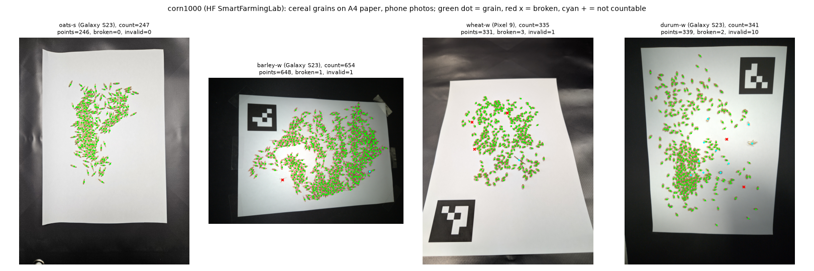

- Page: https://huggingface.co/datasets/SmartFarmingLab/corn1000 (README and metadata.jsonl). Universität Leipzig, Smart Farming Lab; no paper yet. [V]
- 836 photos (train 751: sessions S02 oat, S03 barley, S04 wheat, S05 durum; test 85: `count_1000`, exactly 1,000 grains of 5 species). Cameras: Galaxy S23, iPhone 8, Pixel 9, Galaxy Tab S6 Lite. Photos of 3,000-4,080 px. [V]
- 158 photos have points (40 per session): **101 broken-grain points** and 401 non-countable-object points in total. The number of points differs from `count` by a median of -2 (maximum -24, 4.3%); the README warns about it: the label is `count`. [V]
- Note: the points are in the coordinates of the **EXIF-upright** image (I first drew it wrong; with `exif_transpose` they line up, see figure). [V]
- White A4 background on a dark surface, ArUco markers in some sessions, grains touching in dense areas. [V visual]
- Leakage: each arrangement is photographed 2-22 times; the README asks to split by session. [V README]
- Use: the best open material to validate **counting/segmentation without training** (SAM, Cellpose, threshold + watershed) on phone photos, and for the "% broken" with points. NC: fine for a non-commercial PoC, not for a product.

## 3. GrainSet (per-grain quality, cereals)

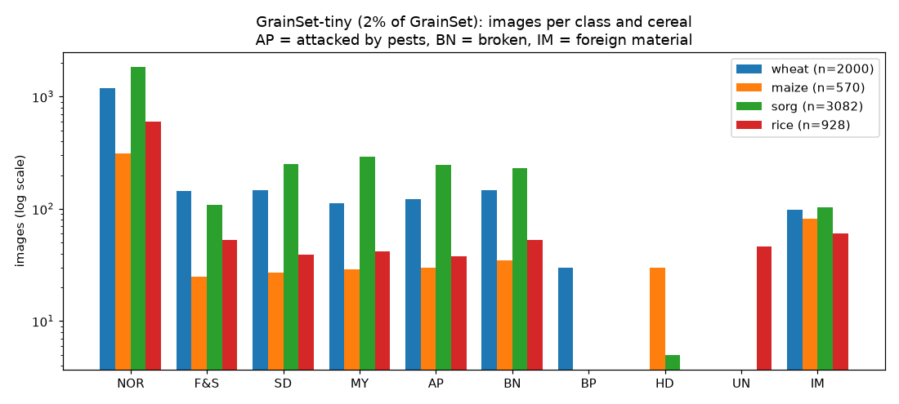
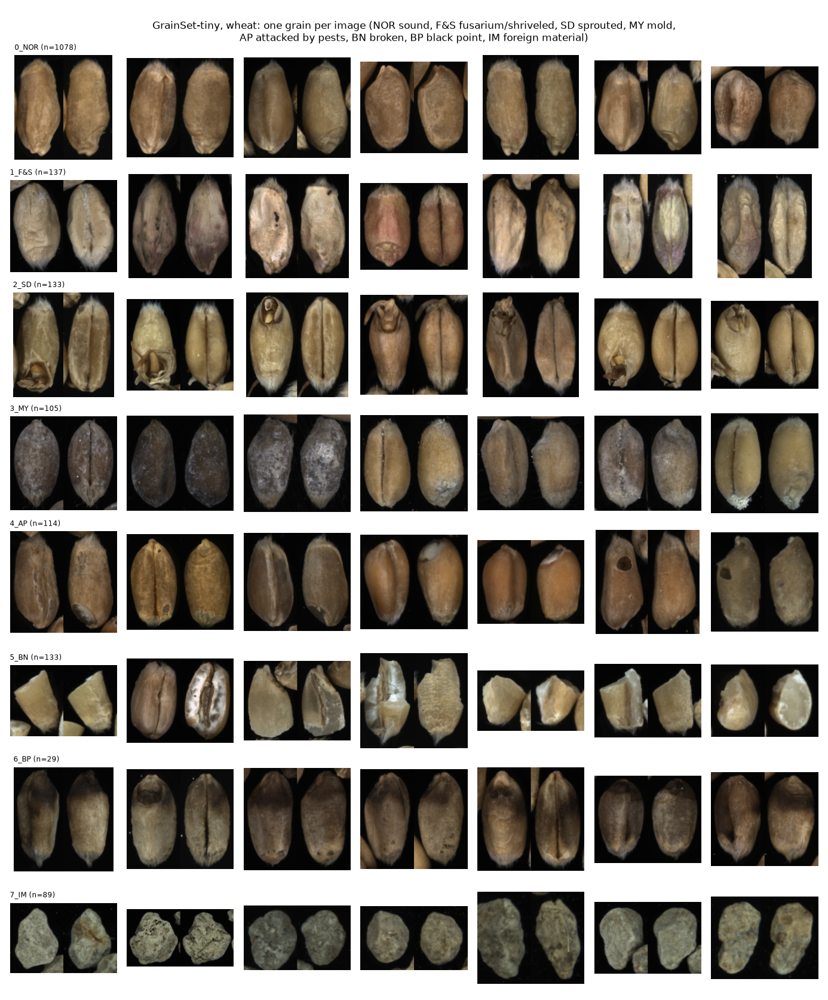
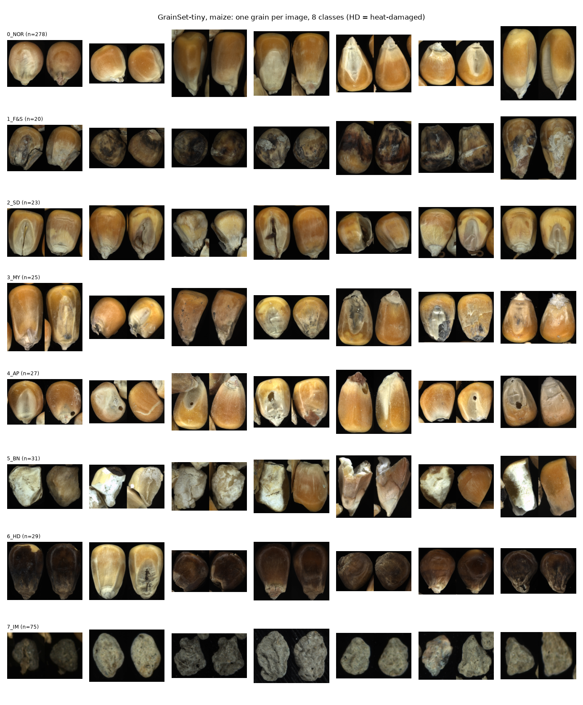
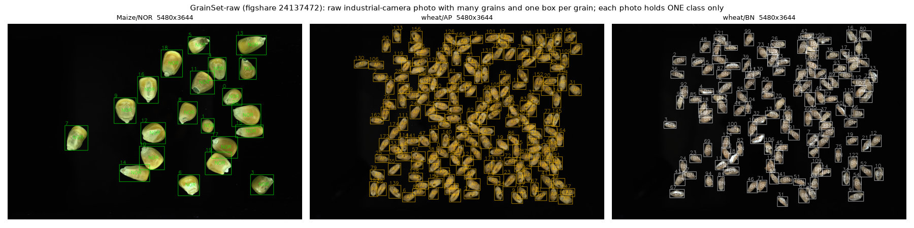

- Open paper: https://pmc.ncbi.nlm.nih.gov/articles/PMC10632488/ ; repo: https://github.com/hellodfan/GrainSet ; figshare 22989029 (tiny, 695 MB), 24137472 (raw, 3.4 GB), 22987562 (maize, 6 GB). All **CC BY 4.0** [V figshare API].
- Acquisition: prototype with a vibrating belt, two industrial cameras (top and bottom) at 5480×3648, ring light; polygon crops, PNG. More than 20 regions in Australia, Cambodia, Canada, China and the USA. [F paper]
- GrainSet-tiny [V]: 6,580 images + 6,580 binary masks; each image is **top|bottom side by side**, ~300 px high. Per class: wheat NOR 1,198, F&S 145, SD 146, MY 113, **AP 123, BN 147**, BP 30, IM 98; sorghum AP 247, BN 230; maize AP 30, BN 35; rice AP 38, BN 53. One XML per species with ID, origin (AU/CAN/CN/USA), date, size and weight per grain.
- Duplicates [V]: 0 identical md5 and 0 identical phash in wheat and sorghum. But grains from the same raw photo fall in train and test: capture batches shared between splits: wheat 46, sorghum 180, rice 12, maize 8. Split by timestamp.
- Label quality [V visual]: very good. AP shows round exit holes and tunnels, BN sharp fragments, IM stones/clods. It is the closest thing to a "bruchid hole" with an expert label and a clean license.
- GrainSet-raw [V, 3 files downloaded via HTTP range requests]: 210 pairs of raw photos 5480×3644 with XML **boxes** per grain (177 grains in one wheat AP photo). Each raw photo is **of a single class** (folders per class), so it works for detection/counting, not for mixtures.

## 4. Pea: instance segmentation (Zenodo 21110940)

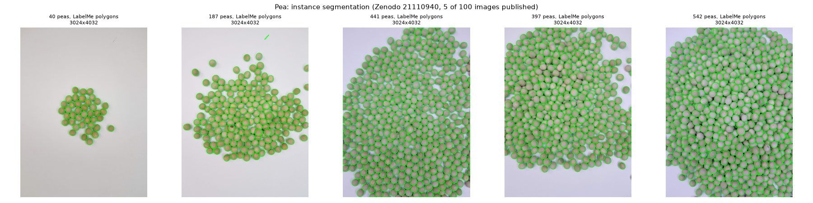

- https://zenodo.org/records/21110940 , CC BY 4.0, 01/07/2026. Unal and Gulzar, manuscript under review. [V]
- 5 phone photos 3024×4032 (April 2021 according to the filename), 40 / 187 / 397 / 441 / 542 peas, all with a LabelMe polygon, a single class `pea`. Dry green peas on white paper, heavily piled in the dense ones. The polygons fit well. [V]
- The full set of 100 images is not public ("on request" according to the description). [V]
- Use: **segmentation benchmark without training** on a real pulse. 2,155 instances are enough to measure the AP of SAM/Cellpose.

## 5. AAFC faba bean (Zenodo 18226381)

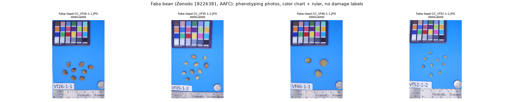

- https://zenodo.org/records/18226381 , CC BY 4.0. The record has **78 JPG** (0.46 GB), not 554 photos and an Excel file as the previous scan said. The description mentions 554 lines. [V]
- 4000×6000, EOS M50, light box, blue background, 24-patch color chart, ruler, 25-cent coin; 3-10 faba beans per photo, separated. [V 4 photos]
- No damage labels. Useful to test faba bean segmentation and sizing, and to show the pipeline with a pulse from the French route.

## 6. Soybean 6 defects, Brazil (Mendeley xnx9bfbh6b)

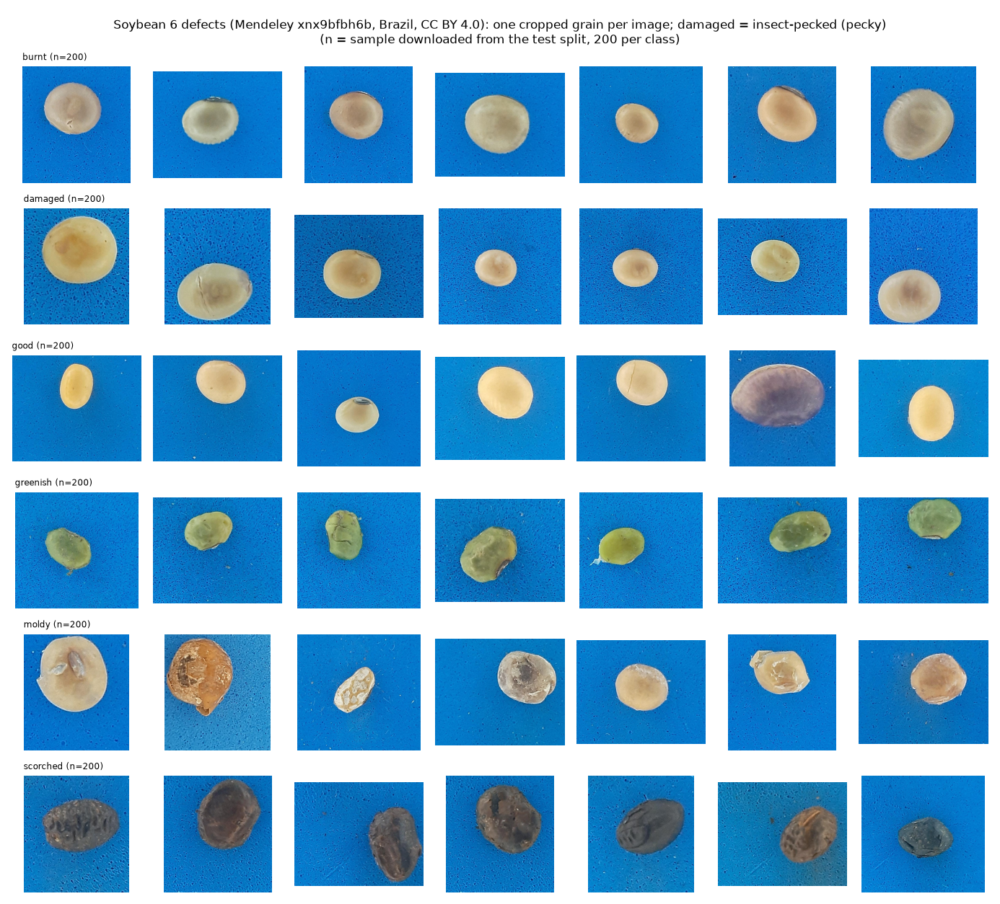

- https://data.mendeley.com/datasets/xnx9bfbh6b , CC BY 4.0, IFPI (Piauí, Brazil), 15/01/2025. Description: 7,328 images, 6 classes, "Pecky: grains damaged by insects or pests". In the files the folder is called `damaged`. [V]
- The API lists 7,100 (training 1,000/962/1,000/816/948/941 and test 272/241/277/205/238/200); the API's cap of 1,000 per folder may explain the difference. [V]
- I downloaded up to 200 per folder (2,312 images). Single-grain crops on blue foam, only 7 distinct sizes between 500×550 and 900×850 (suggests per-batch cropping). In the sample: 1 exact duplicate pair (md5) and 14 groups with identical phash (1 across classes). [V]
- Label quality [V visual]: scorched, greenish and moldy are clear. **"damaged" almost never shows holes**: they are stains or small stink-bug punctures, not bruchids. In "good" there is the occasional broken or purple grain. Useful for "stained/discolored", not for holes.

## 7. Soybean healthy/damaged by phone (Mendeley 65rzpcgbp4)

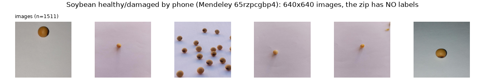

- https://data.mendeley.com/datasets/65rzpcgbp4 v3, CC BY 4.0, 14/09/2026. Infinix HOT 60i, white paper, Roboflow, "YOLO26" paper. [V]
- The zip (`Soybean Dataset.zip`, 43 MB) contains train 1,209 / valid 151 / test 151 images at 640×640 and **zero annotation files**. [V] Without labels it is useless for training. The labels have to be requested from the author.
- Most have a single small grain in the center; few have 10-20 grains. [V visual]
- I tried a near-duplicate detector (phash + pixel difference, including flips): it flags hundreds of pairs across splits, but on inspection they are **different grains** on the same paper. The method does not work for small objects on a plain background; I do not claim leakage here. The filenames (`IMG_date_time`) are all different. [V]

## 8. WheatVision (Mendeley bx27hg9vwd)

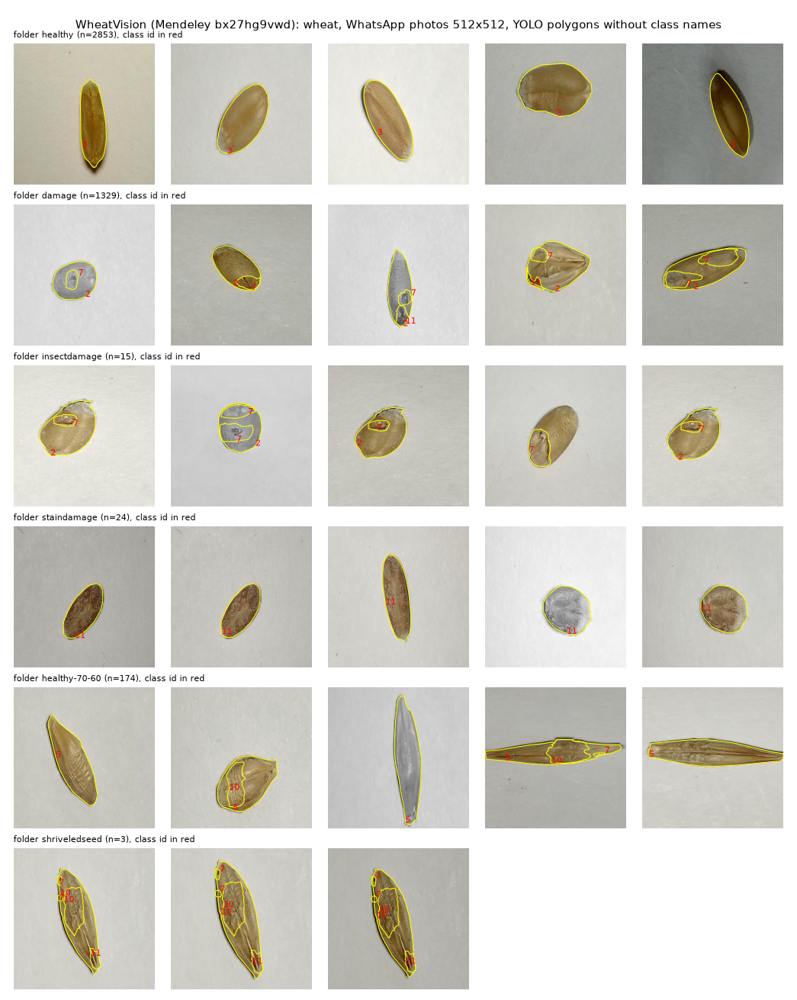

- https://data.mendeley.com/datasets/bx27hg9vwd , CC BY 4.0, Vishwakarma Institute of Technology (Pune), 23/07/2026. WhatsApp photos exported by Roboflow at 512×512. [V]
- 4,482 images = **1,494 originals × 3** (augmentation with grayscale and stretching). 956 originals have copies in more than one split (677 between train and test): **train/test leakage**. [V]
- Annotation: YOLO-seg polygons, 1-6 per image = the grain + defect regions, with 12 numeric ids and no names file. Small classes: insectdamage 15, staindamage 24, shriveledseed 3, objects 3. [V]
- One grain per photo. Only salvageable idea: annotating the **defect region** inside the grain.

## 9. CornViT (Zenodo 17693853)

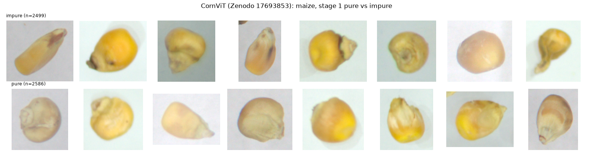

- https://zenodo.org/records/17693853 , CC BY 4.0. Curated and relabeled from a public Kaggle collection of maize seeds (Zenodo record and arXiv abstract 2601.00897). [V]
- Stage 1: 7,265 (pure 3,695, impure 3,570); stage 2 flat/round; stage 3 embryo up/down. Crops of ~136×136, 622 distinct sizes, blurry; 9 groups of exact md5 duplicates (1 across classes). [V]
- "impure" lumps together broken, discolored and silkcut. Of little use.

## 10. Green coffee, 17 defects (Kaggle sujitraarw)

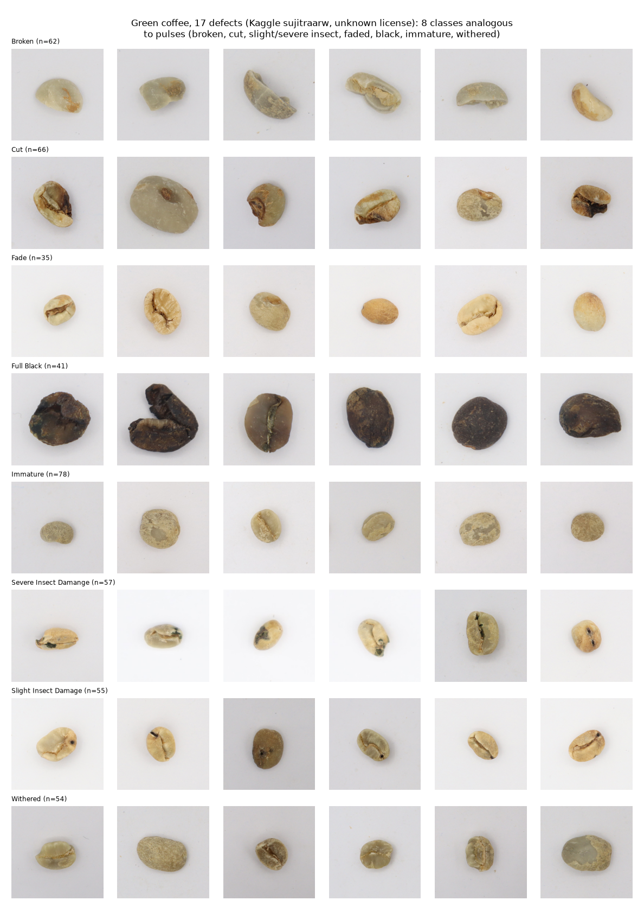

- https://www.kaggle.com/datasets/sujitraarw/coffee-green-bean-with-17-defects-original (Kaggle API): license **Unknown**, 80 MB, 979 JPG 500×500, 35-78 per class. [V]
- Analogous classes: Broken 62, Cut 66, **Slight Insect Damage 55, Severe Insect Damage 57**, Fade 35, Full/Partial Black, Immature 78, Withered 54. [V]
- 13 groups of exact duplicates (md5), 1 across classes. [V]
- Useful as a methodological reference (grading slight vs severe insect damage), not as data: the license is not declared.

## What I looked for and does not exist (or could not be viewed)

- **Pea with pea weevil (*Bruchus pisorum*)** or **bean with *Acanthoscelides obtectus*** in RGB with labels: I found nothing public. Only CT/thermography studies without published images. [V search]
- **Chickpea grain quality**: nothing clean. Mendeley zgph46p46f (Good/Bad, HEIC, ~4 GB) was already in the previous scan; Roboflow "chickpea seeds" (140 imgs) could not be opened. [F]
- **Lentil**: on Kaggle everything is thumbnails or leaf diseases (`truongnhatquangk18dn/lentil` = augmented leaf diseases; `pratikprakhar/hulled-and-unhulled-lentils` = the same "Indian Lentils" thumbnails). [V file listing]
- **Roboflow Universe**: there are small projects ("Object detection Lentil Seeds" 54 imgs, "soyabeanseeddefect1" in a workspace called fababeans, "Defect Soybean", "seeds-detection" CC BY). The page returns 403 (Cloudflare) and the download requires an account and API key. [V 403] [F contents]
- **Toda et al. 2020** (https://github.com/totti0223/crop_seed_instance_segmentation): trains Mask R-CNN only on synthetic collages of barley seeds and reaches 96% recall on real photos [F README/bioRxiv]. The repo **has no license** (GitHub API: `license: null`) and the data is on Google Drive. The recipe is what is valuable: with 20-50 lentil/faba bean crops a synthetic set can be built.

## Recommendation

**(a) Segmentation and counting in multi-grain photos.** Do not train: use a generic model (SAM or Cellpose) and validate it like this:
1. Pea Zenodo 21110940: 5 photos, 2,155 polygons. It is the main metric because it is a pulse.
2. corn1000: 158 photos with points + 836 with exact count, real phone, many grains touching. For "count error %".
3. GrainSet-raw if more volume is needed (boxes, industrial camera).
If something has to be tuned at the event, copy Toda's recipe: synthetic collages with our own crops.

**(b) Broken/split.** GrainSet BN (wheat 147 and sorghum 230 in tiny; thousands in the full set, figshare) as pretraining or as a few-shot gallery; Soybean 5 classes (previous scan, "broken" 1,002) as the closest in shape to a pulse. corn1000 provides 101 broken-grain points in phone photos for testing.

**(c) Insect hole.** The main one is still the soybean bruchid dataset (d97rjyk2tz, other agent). Complement: **GrainSet AP** (wheat 123, sorghum 247 in tiny), which has visible exit holes and expert labels. French validation: **Radio_lentille** from Terres Inovia (X-rays with counts of bruchid-damaged grains). Request access today. Do not use the "damaged" class of the Brazilian soybean (xnx9bfbh6b) as a hole: they are stains.

**(d) Directly on lentil/pea/faba bean.** Radio_lentille (lentil, France, gated) > pea Zenodo 21110940 (5 photos with masks) > AAFC faba bean (78 unlabeled photos). None has sound/broken/holed classes in RGB. For the demo we have to **take our own photos** (a bag of lentils and one of faba beans from the supermarket, break some, photos on A4) and label them by hand; 20-30 photos are enough to validate.

**Licenses.** CC BY 4.0: GrainSet, pea, faba bean, Brazilian soybean, WheatVision, CornViT, phone soybean. MIT: Radio_lentille. CC BY-NC: corn1000 (fine for a PoC; for a product we would need to talk to Leipzig). No license or unknown: coffee 17 defects, Toda: do not redistribute.

## Pages consulted

- https://pmc.ncbi.nlm.nih.gov/articles/PMC10632488/ (GrainSet paper); https://github.com/hellodfan/GrainSet ; figshare API 22989029, 24137472, 22987562
- https://huggingface.co/datasets/SmartFarmingLab/corn1000 ; https://huggingface.co/datasets/JeanEudesH/Radio_lentille (API) ; https://huggingface.co/datasets/lisawen/soybean_dataset ; https://huggingface.co/datasets/cubert-gmbh/XMR_Industrial_Foreign_Object_Detection_Lentils
- Zenodo API 17693853, 21110940, 18226381 ; https://arxiv.org/abs/2601.00897
- Mendeley API xnx9bfbh6b, bx27hg9vwd, 65rzpcgbp4
- Kaggle API: sujitraarw/coffee-green-bean-with-17-defects-original, bangsul12/data-fiks, truongnhatquangk18dn/lentil, pratikprakhar/hulled-and-unhulled-lentils, pankaj7266/grain-dataset
- https://github.com/totti0223/crop_seed_instance_segmentation
- Roboflow Universe (403) and comvis.unsyiah.ac.id/usk-coffee (no response): could not be opened.
