# SoyMate (formerly "idea 9"): audit of the "soybean + bruchid" dataset (Mendeley d97rjyk2tz)

Date: 30/10/2026. No training and no models run: only exploration, statistics and visual inspection.
Tags: **[V]** verified by me on the files or the cited page, **[F]** inferred from what I saw, **[NV]** not verified.

Original scripts in `/private/tmp/claude-501/-Users-fede-bello-develop-hack-the-fork/9fe23a79-8d36-4ec5-81a7-19ddb7a4cabc/scratchpad/cv_soy/scripts/` (`01_inventory.py`, `02_match.py`, `03_groups.py`, `stats.py`, `grids.py`, `dups_split.py`, `common.py`); the copies with English plot labels used to regenerate the PNGs are in `.../scratchpad/en_soy/scripts/`. The raw data was deleted afterwards; the PNGs and `resplit_by_original.csv` remain here.

---

## TL;DR

1. **It works for a PoC of "detect the exit hole", but its published numbers are not valid.** 80% of validation and 84% of test are variants (rotated/mirrored/cropped) of an original photo that is also in train. It has to be re-split by original, and that is possible because **v1 keeps the Roboflow filenames** (`IMG_YYYYMMDD_HHMMSS_jpg.rf.<hash>.jpg`). [V]
2. **Dangerous shortcuts:** 98% of the photos with a black background are of bruchid-damaged seeds, and no "Healthy only" photo has a black background. In addition, every image has **the date printed on it** and the dates separate the classes (9-11/08 bruchid only). A model can learn "black background or date 10/08 = bruchid". [V]
3. **Label quality: acceptable for a PoC, not for measuring.** In 100 random images I found clear errors in ~15 (7 missing boxes, 5 wrong classes, 3 badly drawn boxes) and 9 doubtful ones. Also, "Healthy" does not mean "sound": in 353 images it coexists with defects. [V count, manual estimate]
4. **What transfers to France:** Hole (round exit hole) is morphologically similar to that of *Bruchus rufimanus* in faba bean. Testa cracking only half resembles "broken/dehulled grain". Egg does **not** transfer (Bruchus lays on the pod). [V sources, F comparison]

---

## 1. Dataset sheet

| Field | Value | Tag |
|---|---|---|
| v2 title | "A dataset for soybean seed infestation and quality damage" (17/07/2026). v1 was called "Soybean Seed Infestation Dataset for Pulse Beetle Damage Analysis" (03/06/2026) | [V Mendeley API] |
| Authors | Sayali Shinde, Sail Nagale, Deepa Abin (Vishwakarma Institute of Technology, Pune), Rahul Joshi (Symbiosis International University), Deepak Parashar | [V] |
| DOI | v2: 10.17632/d97rjyk2tz.2; v1: 10.17632/d97rjyk2tz.1 | [V] |
| License | **CC BY 4.0** in both versions. Mendeley text: *"You can share, copy and modify this dataset so long as you give appropriate credit, provide a link to the CC BY license, and indicate if changes were made, but you may not do so in a way that suggests the rights holder has endorsed you or your use of the dataset."* The zip includes a `LICENSE` with "Copyright (c) 2026 Sayali Shinde, Sail Nagale, Dr. Deepa Abin, Rahul Joshi, Deepak Parashar" + a CC BY 4.0 summary | [V] |
| Associated paper | **None.** The API `articles` field is empty in v1 and v2, and I did not find a Data in Brief | [V API, search] |
| Files | v2: one zip `Soybean_Seed_Dataset.zip` (80,157,597 B, sha256 `a45299f0…`). v1: `Train.zip` (63.6 MB), `Validation.zip` (8.0 MB), `Test.zip` (7.9 MB). Sha256 verified against the API | [V] |
| Raw version? | **None**: no 8160×6144 photos are published; both v1 and v2 come at 640×640 | [V] |
| Camera | README: Redmi 13C, f/1.8, automatic AE/AWB/ISO, top-down view. The images have no EXIF (0 tags), but carry a **"REDMI 13C 5G" watermark and a printed date/time** | [V] |
| Format | 2,726 RGB JPEG 640×640, YOLO txt (`class xc yc w h` normalized), `data.yaml`, `image_metadata.csv`, `instance_metadata.csv` (the README calls it `annotation_metadata.csv`) | [V] |
| Capture dates | 09/08/2025 to 18/08/2025 (from the v1 filenames) | [V] |
| Declared validation | intra-annotator κ 0.920, inter-annotator κ 0.759 over 200 images and 1,024 instances | [V README, NV the method] |

**Suggested citation:** Shinde, S., Nagale, S., Abin, D., Joshi, R., Parashar, D. (2026). *A dataset for soybean seed infestation and quality damage* (v2). Mendeley Data. https://doi.org/10.17632/d97rjyk2tz.2. Note: the README bibtex uses the v1 title.

### Structure

```
v2: Soybean_Seed_Dataset/{train,validation,test}/{images,labels}/   names train_0001.jpg ...
v1: Train/Train/{images,annotations}/{Healthy,Normal_Damage,pulse_beetle_damage,Testa cracking}/
    names IMG_20250813_220342_jpg.rf.2feb3c75....jpg   (Roboflow export)
```

- v2 = the 2,693 v1 images **byte-for-byte identical** (md5) + **33 new ones**, renamed and **reshuffled across splits**: only 68% of the images stayed in the same split as in v1. [V]
- In v1 the class ids were different (export with ≥ 8 classes). v1 → v2 mapping verified by matching boxes: 3→Egg, 6→Hole, 1→Testa cracking, 4→Healthy, 0 and 2→Normal_Damage (merged). **v1 class id 7 (113 boxes, scratches/small stains) was removed in v2.** [V]
- The v1 folders are not pure classes: the "Healthy" folder contains 659 Testa cracking boxes. [V]

### Counts per split (v2) [V]

| | train | validation | test | total |
|---|---:|---:|---:|---:|
| Images | 2,180 | 272 | 274 | 2,726 |
| Images without labels | 34 | 5 | 4 | 43 |
| Egg | 7,536 | 1,059 | 1,134 | **9,729** |
| Hole | 1,417 | 182 | 249 | **1,848** |
| Testa cracking | 1,051 | 90 | 124 | **1,265** |
| Normal_Damage | 193 | 23 | 24 | **240** |
| Healthy | 1,148 | 130 | 115 | **1,393** |
| Total boxes | 11,345 | 1,484 | 1,646 | 14,475 |

Matches the README. Images containing each class (all splits): Egg 1,012, Hole 820, Testa 507, Normal 205, Healthy 1,376.

---

## 2. Plots

### 2.1 Class balance
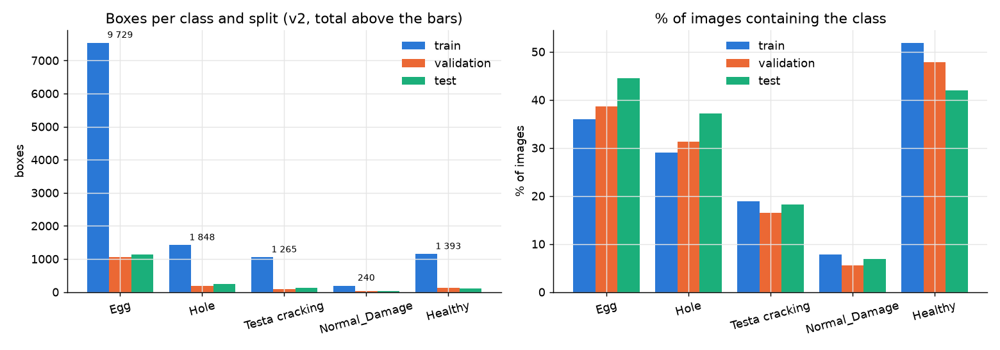

Egg dominates in boxes (67%) because an infested seed has 5 to 30 eggs. At image level it is more balanced: ~37% have eggs, ~30% holes, ~19% cracked seed coat, ~7% Normal_Damage. Normal_Damage is the rare class (240 boxes, 205 images): too little to learn anything reliable. [V]

### 2.2 Boxes per image, size and shape
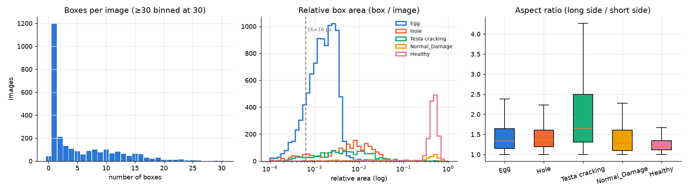

- Median 2 boxes per image, mean 5.3, maximum 36. The peak at 1 is the photos with a single Healthy box. [V]
- **Egg is tiny:** median 0.16% of the area (≈ 25×25 px at 640). Hole median 0.61% (≈ 47 px wide), Testa 0.48%. Healthy encloses the whole seed (median 47% of the area). [V]
- **Normal_Damage is bimodal:** sometimes it is a whole-seed box (shriveled, moldy seed) and sometimes a small spot. It is a poorly defined class. [V]
- Testa cracking is the most elongated (median aspect ratio 1.65), consistent with cracks. [V]

### 2.3 Background and date: shortcut risk
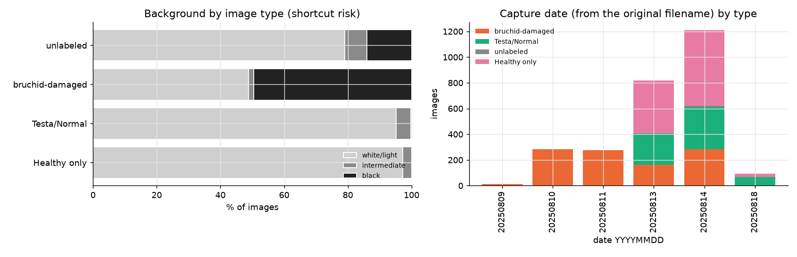

- Background (brightness of the image border): 2,136 light, 513 black, 77 intermediate. Of the 513 black ones, **505 are bruchid-damaged seeds**. The "Healthy only" images have **0** black backgrounds. [V]
- Dates: 9, 10 and 11/08/2025 are **100% bruchid-damaged seeds**. Sound, cracked and Normal_Damage seeds were photographed on 13, 14 and 18/08. Since the date is printed on the photo, it is a readable shortcut. [V]
- Consequence: for the PoC we have to (a) crop to the seed (bounding box from the segmentation) to remove the background and watermark, or at least mask the corners, and (b) test "bruchid on light background" (498 images) separately, which is the honest comparison. [F]

### 2.4 What each class looks like

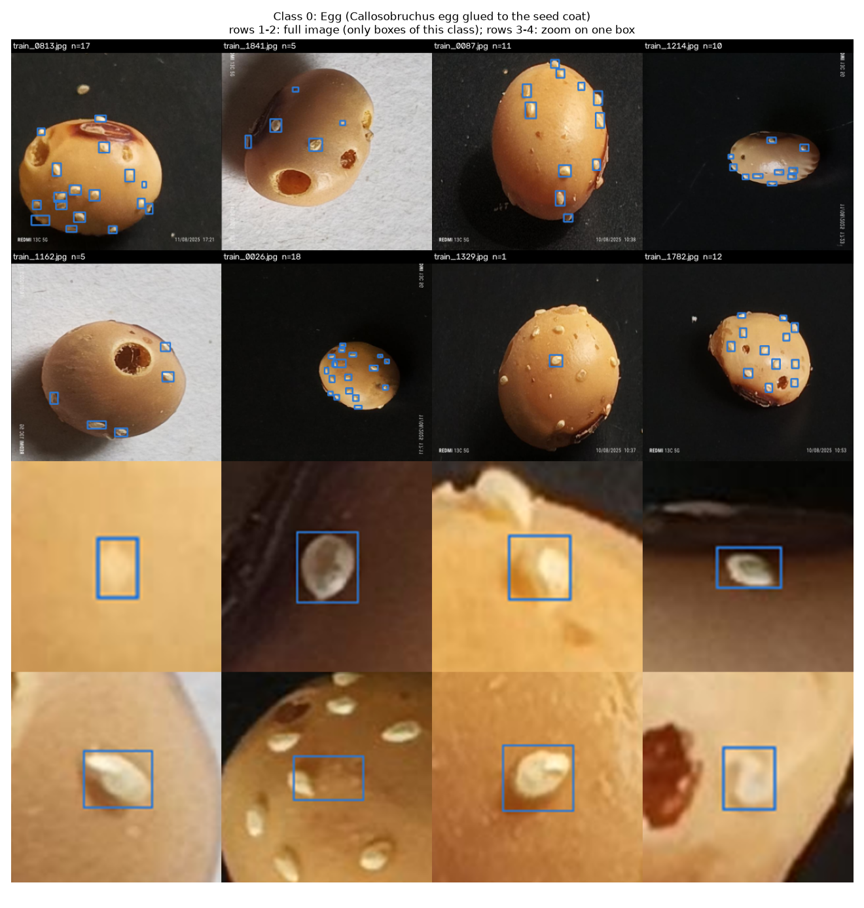
**Egg:** white oval eggs glued to the seed coat, many at a time. The boxes are usually tight, but there are **eggs without a box**: `train_1329` has a single Egg box with more than 15 visible eggs, and in `train_0026` a box is shifted onto empty seed coat. Counting eggs with this dataset underestimates. [V]

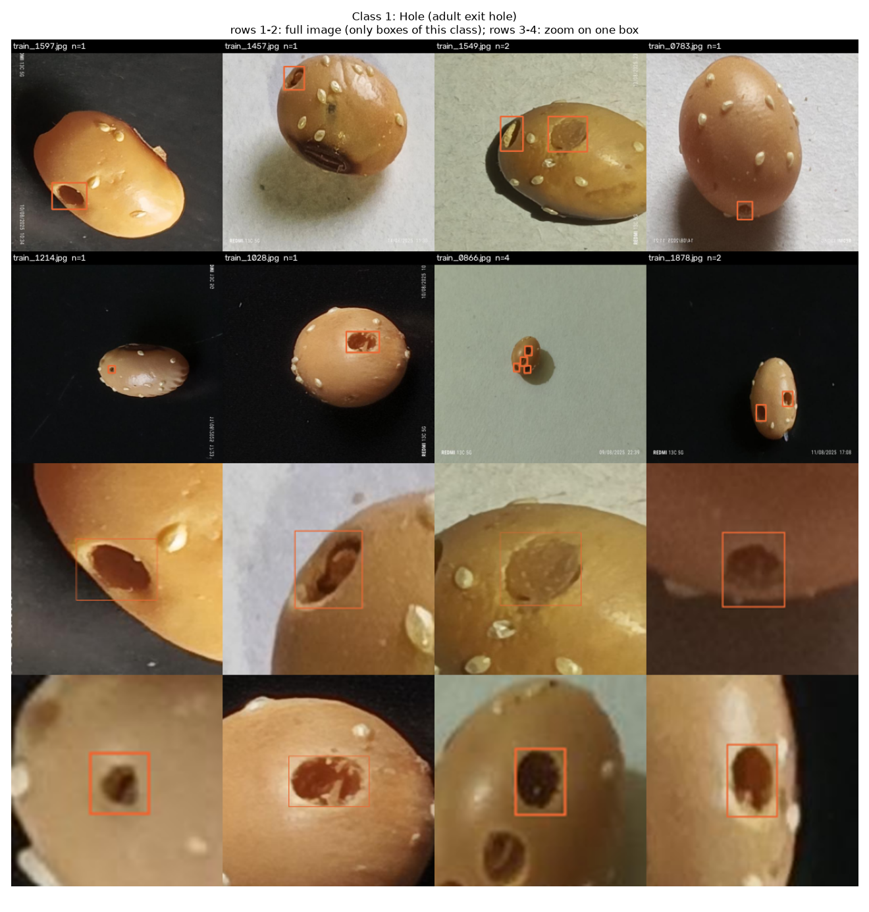
**Hole:** round/oval holes with a clean edge, sometimes a "window" (the disc of seed coat not yet opened, lighter). Tight boxes. In some images there is a second hole without a box. [V]

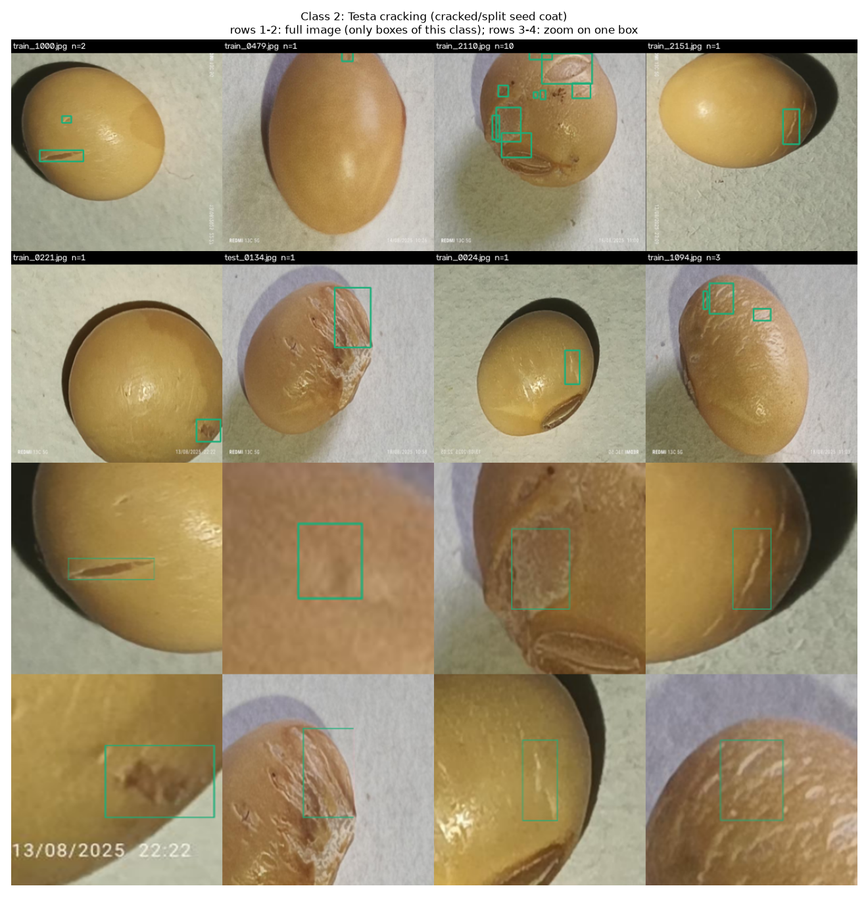
**Testa cracking:** from fine cracks to detached seed coat. There are boxes over areas where nothing clear is visible (e.g. `train_0479`, second box of `train_1000`). It is the noisiest class. [V]

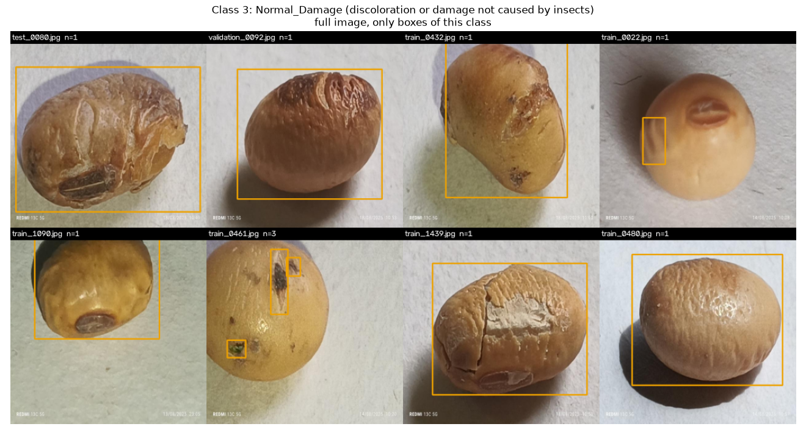
**Normal_Damage:** shriveled/shrunken seeds, with mold or mechanical damage, sometimes a whole-seed box and sometimes small spots. [V]

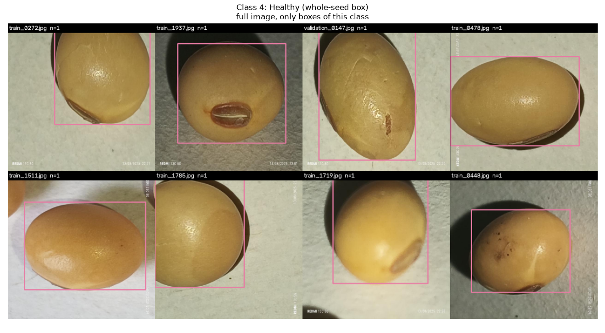
**Healthy:** whole-seed box. Note: it is not "sound seed", it is "seed from the session without bruchids" (see 3.2). [V]

### 2.5 Duplicates and leakage
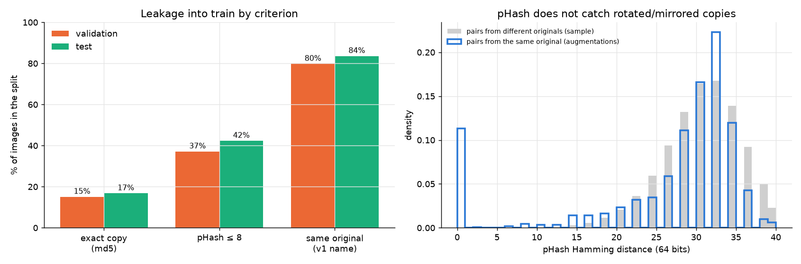

- **Each original photo appears 1 to 3 times** (334 originals with 1 image, 146 with 2, 689 with 3 in v1): they are Roboflow augmentations already baked in (90° rotation, mirroring, crop/zoom). It also shows because the watermark appears rotated. [V]
- **250 pairs are byte-for-byte copies** (same md5, different name); 94 of those pairs already crossed splits in v1. [V]
- Leakage into train in v2:
  - exact copy (md5): 15% of validation, 17% of test;
  - pHash ≤ 8: 37% / 42%;
  - **same original (by v1 name): 80% of validation (217/272) and 84% of test (229/274).** [V]
- The previous scan (53 in test) underestimated the leakage because pHash does not see the rotated versions: the distance distribution of pairs from the same original is almost the same as that of different pairs, except for the peak at 0 (exact copies). Grouping by v1 name is the only reliable method. [V]

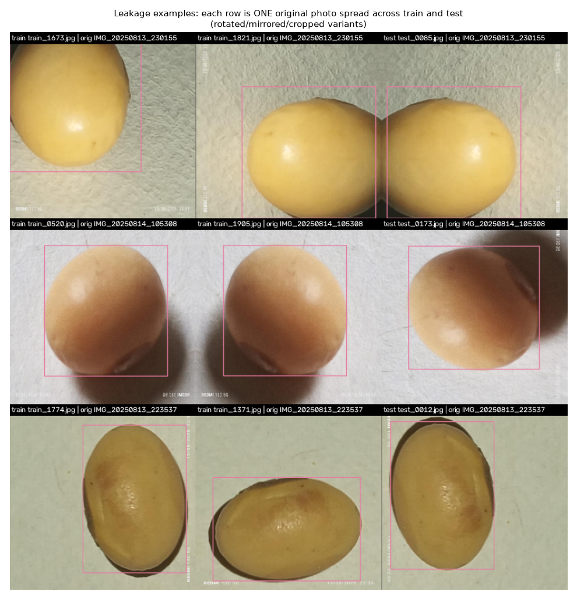

### 2.6 Label errors
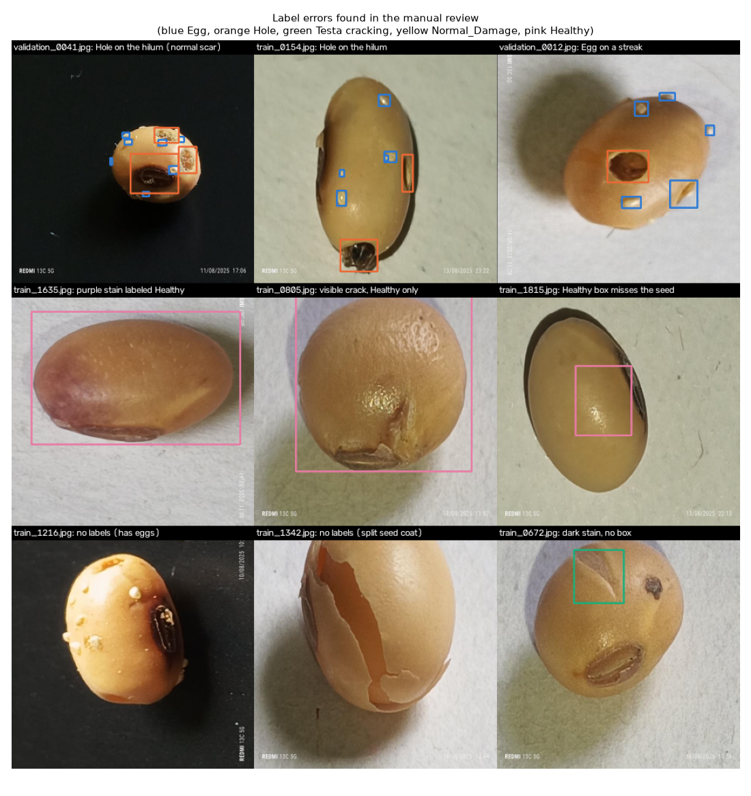

---

## 3. Label quality

### 3.1 Manual review of 100 random images (seed 2026, all splits)

| Type | Images | Examples |
|---|---:|---|
| Missing boxes (unlabeled image with visible defect, or obvious defect without a box) | 7 | `train_2040`, `train_1216` (empty), `train_1817`, `validation_0218`, `train_0784`, `train_0672`, `train_0805` |
| Wrong class | 5 | hilum marked as Hole (`validation_0041`, `train_0154`), streak as Egg (`validation_0012`, `train_1926`), purple stain as Healthy (`train_1635`) |
| Badly drawn box (does not cover the seed, overlapping/loose boxes) | 3 | `train_1815`, `train_0862`, `train_0754` |
| **Total with a clear error** | **15** | |
| Doubtful (small boxes over nothing visible at 640 px, or ambiguous defect) | 9 | `train_1100`, `train_1829`, `test_0215`, `validation_0147`... |
| Blurry/out-of-focus image (despite the "blur detection") | 2 | `train_0454`, `train_1795` |

Manual estimate: **~15% of images with at least one clear error (95% CI approx. 9-23%); the Egg and Hole boxes that exist are almost always well placed.** The errors concentrate in Testa cracking, Normal_Damage and the Healthy box; in Egg/Hole the typical problem is the missing box, not the misplaced one (outside the sample I saw a serious case: `train_1329`). [V count, F extrapolation]

### 3.2 Systematic problems [V]

- **The 33 new v2 images are almost all unlabeled (32 of 33)**, and many show eggs, holes or split seed coat (`train_1881`, `train_1342`, `train_1216`...). They are false "background". There are 11 more empty ones among the v1 images.
- **"Healthy" ≠ sound:** of the 1,376 images with a Healthy box, **353 (26%) also have Testa cracking, Normal_Damage, Egg or Hole**. Conversely, bruchid-damaged seeds almost never have a seed box. In other words: Healthy works as a "seed box" only in the sessions without bruchids.
- The minor-damage class that existed in v1 (id 7) was deleted in v2 without reassignment: those stains were left without a box.
- 640×640 images from a 4:3 original without black bars: they were probably stretched or cropped in the export [NV].

**Verdict:** usable for a PoC detecting **Egg** and **Hole**, and for image-level classification "with hole / without hole". Not usable as is to measure mAP or for the Normal_Damage class. Testa cracking works as a weak signal.

---

## 4. Seeds per image

- **Yes, it is one seed per photo in 97.8% of cases.** Saturation-based segmentation: 2,665 images with a single large component, 61 (2.2%) with two. [V]
- The cases with two: a second seed cut off at the border (sometimes with boxes, e.g. `train_0832`) or **an adult *Callosobruchus*** in the photo (`train_1382`, `train_1384`, `train_1501`). 11 images have 2 or 4 Healthy boxes. [V]
- The seed occupies a median 36% of the frame (macro). A soybean seed is ~6-7 mm, so at 640 px there are ~50-60 px/mm [F]. In a tray photo with 100 grains you will have ~10-20 px/mm: a ~1-2 mm hole ends up at 10-40 px, still detectable but borderline for eggs [F].

---

## 5. Leak-free re-split (proposed)

File: [`resplit_by_original.csv`](resplit_by_original.csv) (one row per v2 image: `image_v2, original_split, group, new_split, discard, n_labels, background, type`). Values: `new_split` is train, val, test or empty if discarded; `discard` is empty, `exact copy (md5)`, `extra v2 unlabeled` or `unlabeled`; `background` is `white/light`, `intermediate` or `black`; `type` is `bruchid-damaged`, `Testa/Normal`, `Healthy only` or `unlabeled`.

Rules:
1. **Group = original photo** (`IMG_YYYYMMDD_HHMMSS` prefix of the v1 name, matched via md5). The 33 new v2 images have no original name; since 32 are unlabeled they are discarded, and `train_2047` stays as its own group.
2. **Discard:** 249 exact copies (repeated md5, one is kept), 32 new unlabeled images, 11 empty v1 images. 2,434 images remain in 1,166 groups.
3. 70/15/15 split **by group**, stratified by image type (bruchid / testa-normal / Healthy only) and background (light / black / intermediate), seed 42.

| | train | val | test |
|---|---:|---:|---:|
| Groups (originals) | 816 | 175 | 175 |
| Images | 1,715 | 354 | 365 |
| Egg | 6,254 | 1,313 | 1,307 |
| Hole | 1,211 | 244 | 240 |
| Testa cracking | 730 | 210 | 223 |
| Normal_Damage | 154 | 34 | 24 |
| Healthy | 863 | 185 | 208 |

I verified that no group falls in two splits. [V] Extra recommendation: for test use **a single image per group** (the first one), so variants are not counted twice, and report the "light background" subset separately. [F]

---

## 6. Does the soybean "Hole" look like the *Bruchus* hole in faba bean/lentil?

What the sources I opened say:
- *Bruchus rufimanus* (bruche de la féverole, "faba bean bruchid"): the female lays eggs on the **developing pods**, the larva goes through the pod and into the grain, and the adult exits by chewing through the grain wall, leaving a **circular hole**; there can be more than one per grain ([Bayer Crop Science UK](http://cropscience.bayer.co.uk/threats/pest-and-slugs/bruchid-beetle/)). [V]
- RHS: circular holes of "just over 1 mm" in dried broad beans; eggs on the pods in early summer; adults that can emerge in winter in heated places ([RHS](https://www.rhs.org.uk/biodiversity/broad-bean-seed-beetle)). [V]
- Teagasc (poster Pichon et al., Ento24): the larva consumes the inside of the grain and leaves "a characteristic round hole when exiting the seed"; **for the European market, a lot cannot be sold for human consumption with more than 1-3% damaged grains, and 10% for animal feed** ([poster PDF](https://royensoc.co.uk/wp-content/uploads/2024/09/P35-–-Antoine-Pichon-Ento24-Poster.pdf)). The photo in the poster shows faba beans with open round holes, a lighter unopened "window" and dark halos around them. [V]
- *Callosobruchus maculatus*: the female **glues eggs onto the grain** (transparent, shiny, ~0.75 mm), the larva leaves "a very thin layer through which it will exit" ([Wikipedia](https://en.wikipedia.org/wiki/Callosobruchus_maculatus)). [V] It is a storage pest that reproduces in stored grain [F from the same source, which mentions higher reproduction in storage].

Visual comparison (dataset vs poster photo) [F]:
- **Hole transfers well in shape:** round hole with a clean edge and an opercular "window" in both cases. What changes is the relative size (faba bean is ~2-3 times larger than soybean, so the hole covers a smaller fraction of the grain), the seed coat color (faba bean brown/green, lentil green/blond, darker than yellow soybean) and the contrast of the hole.
- **Egg does not transfer:** with *Bruchus* the eggs go on the pod, so there are no eggs on the threshed grain. In the pitch, do not promise to detect eggs on French pulses.
- **Testa cracking ≈ "broken / dehulled / cracked grain"** of the commercial standard, but the dataset mixes fine seed-coat cracks with detachments; for "split in two" (separated cotyledons) there are no examples. It half transfers.
- **Normal_Damage** (shriveled, mold, discoloration) resembles "stained/spotted grain", but with 240 boxes and an ambiguous definition it is better not to use it.
- **Healthy** works as "whole seed" only if filtered to images without other boxes.

---

## 7. What to use for the PoC

1. **Task 1 (core):** **Hole** detector (+ Egg as a bonus for soybean only), trained on the re-split, on crops centered on the seed. Seed-level metric: "has ≥ 1 hole" (820 positive images in v2).
2. **Task 2 (per-seed classification):** labels derived per image: `bruchid` (Hole or Egg), `damaged testa` (Testa without Hole/Egg), `sound` (Healthy only). Discard Normal_Damage or merge it into "damaged".
3. **Transfer:** the small faba bean/lentil/pea set photographed at the event serves as the real test set and for fine-tuning (after 30/10). Soybean only provides the prior of "what a bruchid hole is".
4. For the human food vs animal feed decision, the rule comes from the Teagasc poster: >1-3% damaged grains disqualifies for human consumption. The model gives the % per class; the rule is explicit and explainable.

## 8. What to say in the pitch

- "We pretrained on an open CC BY dataset of **soybean for human consumption** attacked by the pulse beetle (*Callosobruchus*), 1,169 original photos, and validated it on French grains photographed here." (Track 3: soybean = tofu/soy drink, not animal feed.)
- "We audited the dataset: the published split has 84% leakage and a background shortcut; we re-split it by original photo." This shows rigor and beats the typical "99% accuracy".
- "We detect the exit hole, which is the symptom the cooperative sees with *Bruchus*. We do not promise eggs: in France the bruchid lays on the pod."
- Mandatory attribution (CC BY): cite authors and DOI on the data slide.

## 9. Risks

| Risk | Impact | Mitigation |
|---|---|---|
| Train/test leakage (80-84%) | Inflated metrics | Re-split by original (done), one image per group in test |
| Black-background / printed-date shortcut | The model learns the background, not the hole | Crop to the seed, mask the watermark, test on light background |
| ~15% of images with label errors, ambiguous Healthy | Noise, performance ceiling | Use Egg/Hole, filter Healthy with other boxes, discard empty images |
| Domain: one seed in macro vs a handful on a tray | Sharp drop when moving to lot photos | Segment → crop → classify pipeline; our own tray photos |
| Different species and pest (soybean/*Callosobruchus* vs faba bean/lentil/*Bruchus*) | Uncertain transfer in size/color | Own transfer set; talk about a "prior", not a final model |
| Augmentations already baked in, no 8160×6144 originals | Cannot re-augment from the source or use more resolution | Accept it; use only one variant per group for a clean set |
| No associated paper | Annotation protocol cannot be audited | Cite the dataset DOI and our audit |

## Sources opened

- Mendeley Data API, dataset v1 and v2: https://data.mendeley.com/public-api/datasets/d97rjyk2tz?version=2 (and `version=1`), and file listing `.../files?folder_id=root&version=N`.
- Bayer Crop Science UK, bruchid beetle: http://cropscience.bayer.co.uk/threats/pest-and-slugs/bruchid-beetle/
- RHS, broad bean seed beetle: https://www.rhs.org.uk/biodiversity/broad-bean-seed-beetle
- Pichon, Nolan, Alves, McNamara (Teagasc/SETU), Ento24 poster "Impact of bruchid beetle on the agronomic value of faba bean seeds": https://royensoc.co.uk/wp-content/uploads/2024/09/P35-–-Antoine-Pichon-Ento24-Poster.pdf
- Wikipedia, *Callosobruchus maculatus*: https://en.wikipedia.org/wiki/Callosobruchus_maculatus
